# 디즈 워치 · 마음섬

**한국어 건강 앱 UI와 청소년의 감정·일상 돌아보기를 연결하는 오프라인 게임 프로토타입**

SMART-TIME PRO 복원 작업 공간을 바탕으로 기존 건강·운동·워치·프로필·설정 화면을 한국어와 캐릭터·파스텔 카드 UI로 통일하고, 건강 홈에서 열리는 **마음섬**을 추가했습니다. 마음 날씨를 남기고, 작은 퀘스트로 씨앗을 모아 나만의 섬을 꾸밀 수 있습니다.

| 항목 | 현재 상태 |
| --- | --- |
| 커스텀 앱 | **디즈 워치 0.6.0** · `com.diz.sw01.custom.ui` · versionCode `6` |
| 추가 기능 | 워치 기반 활동 추천·추가 300걸음 미션, 마음 날씨·메모, 섬 꾸미기, 1분 호흡·쉼 기록 |
| 실행 확인 | 0.6.0 Galaxy S25 / Android 16 업데이트 설치·로컬 저장소 읽기·실제 심박 표시 확인. 실제 추가 300걸음 완료는 후속 사용자 확인 |
| 워치 | Diz-SW01 실물 연결·수치 동기화 사용자 확인. 0.6.0은 저장된 건강 기록을 마음섬 추천·미션에 연결 |
| 개발 형태 | 기존 앱은 **Smali·리소스 재조립**, 새 마음섬은 Java Activity + 로컬 HTML/CSS/JS |
| 문서·캡처 기준 | **2026-11-03**, 0.5.0 실제 폰 6장 + 0.4.0 실제 폰 7장 + 0.3.0 에뮬레이터 27장 |
| 배포 상태 | 팀 검토용 프로토타입. 스토어 배포·실기기 안전 판정·임상 효과 검증 완료 상태가 아님 |

> 처음 합류한 팀원은 **[화면별 설명](docs/SCREENS.md) → [빠른 실행·빌드](#빠른-실행빌드) → [팀 작업 안내](docs/TEAM_GUIDE.md)** 순서로 보세요.
>
> 화면의 기분·메모·씨앗·꾸미기는 설명을 위해 만든 **예시 데이터**입니다. 실제 청소년의 감정 기록이나 건강 측정값이 아닙니다. 개인 프로필과 계정 ID가 노출되는 화면은 공개 캡처에서 제외했습니다.

<table><tr><th>건강 홈 → 마음섬 진입</th><th>나만의 작은 섬</th></tr><tr><td>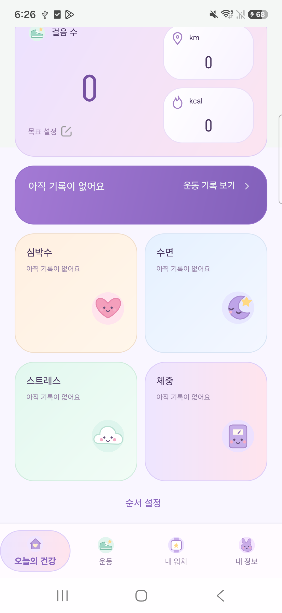</td><td>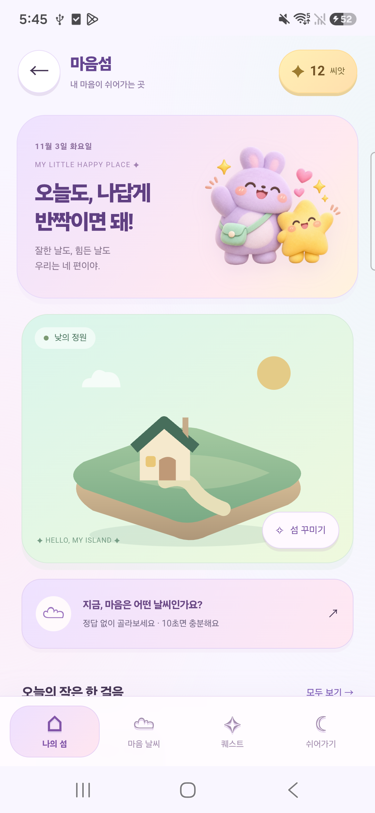</td></tr></table>

## 워치와 상호작용하는 마음섬 · 0.6.0

**[데이터 연결·추천 규칙·미션 사용법](docs/WATCH_COACH.md)**

마음섬 홈에서 동기화된 걸음·수면·최근 심박을 확인하고, 실제 기록과 직접 남긴 마음·쉼 느낌에 따라 산책·몸 풀기·쉬어가기를 선택합니다. 퀘스트의 **추가 300걸음**은 시작 이후 동기화된 실제 걸음으로 진행되며, 직접 완료하는 움직임 퀘스트와 일일 보상을 공유합니다. 연결·등록·펌웨어 코드는 바꾸지 않았습니다. 게임 목표는 권장 운동량이나 의료 처방이 아닙니다.

## 앱 전체 공통 테마 · 0.5.0

마음섬뿐 아니라 **건강·운동·내 워치·내 정보·설정**과 공통 상세 화면을 같은 캐릭터·파스텔 콘셉트로 맞췄습니다. 운동의 회색 배경·주황 시작 버튼, 건강의 선형 아이콘, 프로필·설정 목록과 스위치도 변경했습니다.

**[실제 폰 화면 6장과 수정 범위](docs/APP_WIDE_THEME.md)** · [0.5.0 검증 기록](analysis/teen-ui-0.5.0-verification.json)

커스텀 패키지에서 원 제조사 자동 앱 버전 검사를 분리해 온라인 실행 시 원 앱으로 교체하라는 강제 안내가 주요 화면을 막지 않게 했습니다. 설정의 수동 업데이트 메뉴와 별도 커스텀 배포 채널은 후속 정리가 필요합니다. 워치 펌웨어 업데이트 경로는 유지했습니다.

## 캐릭터 디자인 기록 · 0.4.0

시작·로그인 선택 화면의 인물 사진을 캐릭터로 교체하고, 마음섬에 토끼·별 친구와 라벤더·민트·복숭아색 UI를 적용했습니다. Android 16의 시스템 바·키보드 여백도 별도로 처리합니다. [변경 화면·소스·생성 이미지 설명](docs/TEEN_UI.md)을 참고하세요.


0.4.0 빌드 프로필은 `profiles/diz-sw01-teen-ui.json`입니다. 아래 27장 갤러리와 기존 검증 표는 **0.3.0 기록**이며, 0.4.0 변경 내역은 위 문서에서 구분합니다.

## 목차

- [프로젝트 구성과 구현 범위](#프로젝트-구성과-구현-범위)
- [앱 화면 하나씩 보기](#앱-화면-하나씩-보기)
- [게임 규칙과 데이터](#게임-규칙과-데이터)
- [구조와 소스 위치](#구조와-소스-위치)
- [빠른 실행·빌드](#빠른-실행빌드)
- [테스트와 검증 범위](#테스트와-검증-범위)
- [알려진 제약과 다음 작업](#알려진-제약과-다음-작업)
- [협업·문서·원본 자료](#협업문서원본-자료)

## 프로젝트 구성과 구현 범위

### 1. 기존 건강 앱 커스터마이징

기준은 SMART-TIME PRO **2.1.3.4**, 원래 패키지는 `com.sma.smartv3.pro`, 대상 워치는 Diz-SW01입니다. 이 저장소는 [상위 복원 저장소](https://github.com/dlwlsrnjs/custom_smart-time-pro)를 포크한 작업 공간입니다.

- 건강 홈·워치 연결 카드·하단 메뉴의 색상, 카드, 아이콘과 한국어 기본 문구를 수정했습니다.
- 복원 Java는 구조를 읽는 자료입니다. **전체를 Android Studio에 가져와 Gradle로 바로 빌드하는 원본 프로젝트가 아닙니다.**
- 제조사 연결 SDK·네이티브 라이브러리·기존 계정 및 건강 데이터 경로를 포함하고 있습니다. 이를 모두 새로 개발하거나 검증한 상태가 아닙니다.
- 원 앱이 Diz-SW01과 연결된다는 사용자 확인은 있었지만, 이 사실은 새 서명·새 앱 ID의 커스텀 앱 연결을 보장하지 않습니다.

### 2. 새로 구현한 마음섬

| 기능 | 사용자가 하는 일 | 저장되는 내용 | 보상 |
| --- | --- | --- | --- |
| 마음 날씨 | 맑음·잔잔함·흐림·비·바람 중 선택 | 날짜, 선택한 날씨, 선택 메모 최대 200자 | 하루 첫 저장 씨앗 5개, 모든 날씨 동일 |
| 나의 섬 | 배경과 꾸미기 재료·자리 선택 | 배경, 소유 목록, 배치 3자리 | 재료 구입에 씨앗 사용; 재배치는 무료 |
| 작은 퀘스트 | 움직임·작은 용기·휴식을 **직접 완료 기록** | 날짜별 완료 보상 이력, 선택한 행동 | 각 퀘스트 하루 한 번 4개 |
| 1분 호흡 | 시작·일시정지·이어서 진행·그만두기 | 완료한 날짜의 보상 이력 | 실제 누적 60초 첫 완료 3개 |
| 쉼 기록 | 어젯밤 주관적으로 느낀 쉼 선택 | 날짜와 선택 값 | 없음. 점수로 평가하지 않음 |
| 기록 삭제 | 삭제 안내를 보고 확인 | 마음·메모·쉼 제거; 꾸미기·씨앗·보상 이력 유지 | 삭제로 보상을 다시 만들지 않음 |

**워치 없이도 마음 기록·직접 완료하는 퀘스트·호흡·섬 꾸미기를 사용할 수 있습니다.** 0.6.0의 추가 300걸음 미션은 실제 동기화 기록이 필요하며, 워치 기록이 없으면 직접 활동 선택으로 안내합니다. 워치 생체정보로 우울·불안을 추정하지 않습니다.

## 앱 화면 하나씩 보기

**0.5.0 네이티브 화면 6장은 [전체 테마 문서](docs/APP_WIDE_THEME.md), 캐릭터 게임·로그인 화면 7장은 [0.4.0 기록](docs/TEEN_UI.md)에 있습니다. 아래는 0.3.0 기능·상태 갤러리입니다.**

모두 실제 APK의 에뮬레이터 화면입니다. 합성 시안이 아니며 PNG 원본은 `docs/screenshots/`에 있습니다. 표의 번호는 [화면 명세서](docs/SCREENS.md) 및 [캡처 목록](docs/screenshots/manifest.json)과 같습니다. 화면은 서로 다른 설명용 상태를 보여주므로 모든 이미지가 하나의 연속 사용 세션을 뜻하지는 않습니다.

### 기존 앱의 주요 탭과 설정

<table><tr><th>01. 건강 홈과 마음섬 진입</th><th>02. 기존 운동 탭</th></tr><tr><td>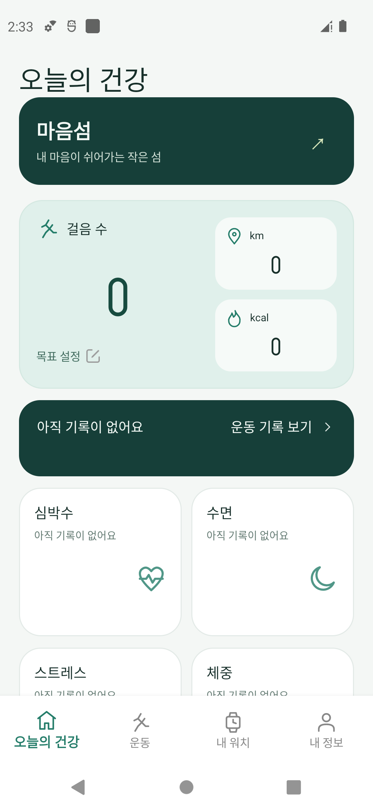</td><td>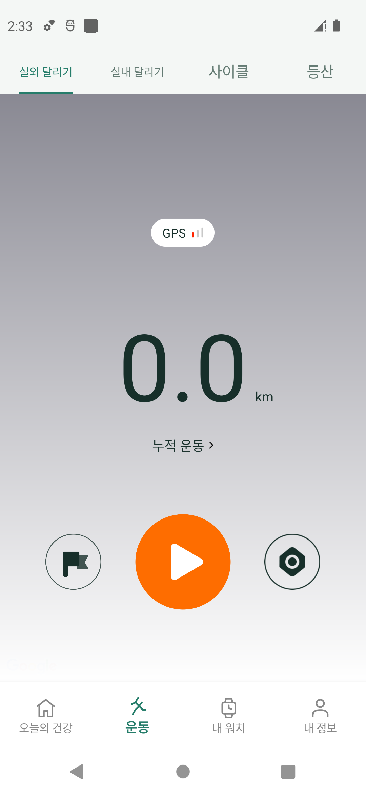</td></tr><tr><td>한국어 건강 카드와 새 마음섬 진입 카드. 걸음·거리·열량은 미연결 상태의 0으로 표시된다.<br/><br/>기존 건강 데이터 화면이며, 마음섬 카드가 새로 추가되었다.</td><td>실외·실내 달리기 등 원 앱의 운동 UI.<br/><br/>화면 진입만 확인했다. GPS·운동 기록·워치 실동작 검증 완료를 뜻하지 않는다.</td></tr></table>

<table><tr><th>03. 내 워치</th><th>04. 기존 앱 설정</th></tr><tr><td>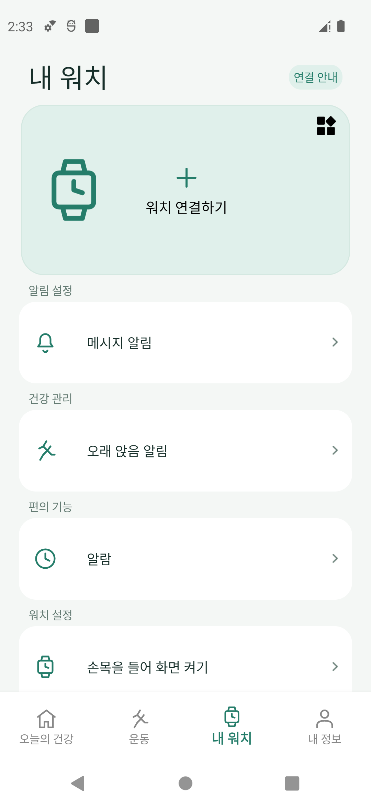</td><td>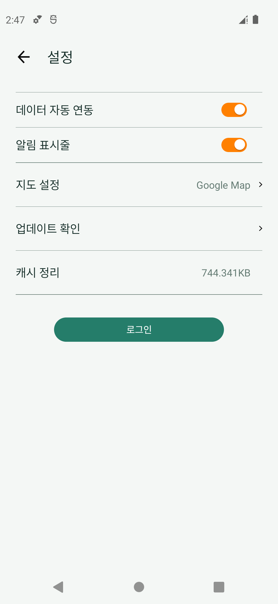</td></tr><tr><td>워치 연결 카드와 알림·건강 관리·편의 기능 메뉴.<br/><br/>Diz-SW01 실제 연결·동기화는 미검증이다.</td><td>원 앱의 설정 진입 화면.<br/><br/>프로필 이름·계정 ID가 보이는 내 정보 상단은 공개 캡처에서 제외했다.</td></tr></table>


### 나의 섬과 꾸미기

<table><tr><th>05. 나의 섬 — 첫 방문</th><th>08. 나의 섬 — 꾸미기와 오늘의 마음</th></tr><tr><td>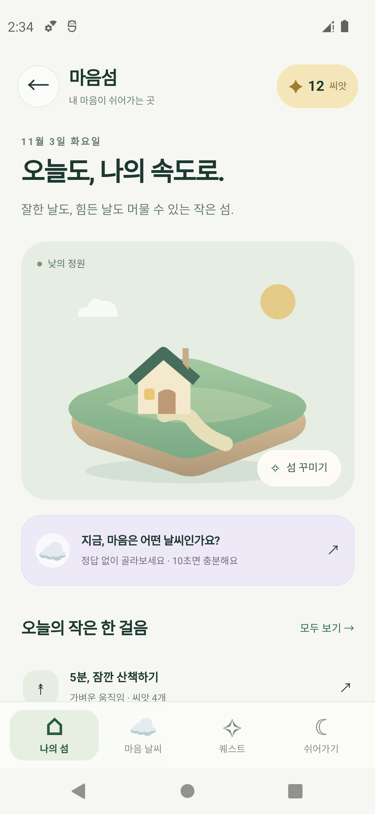</td><td>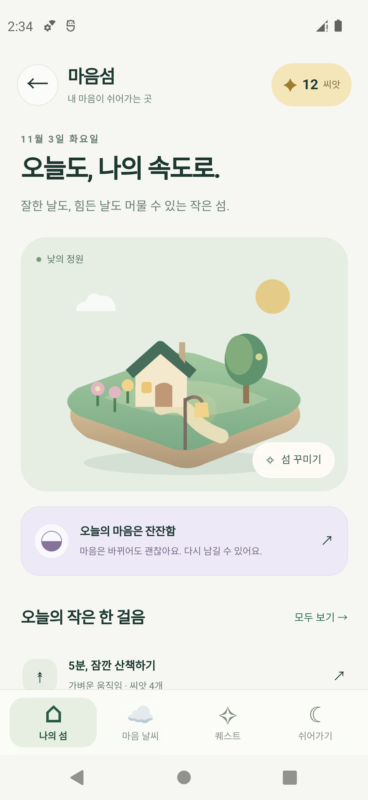</td></tr><tr><td>작은 집이 있는 기본 섬, 시작 씨앗 12개, 마음 기록과 퀘스트로 가는 진입점.<br/><br/>처음에는 꾸미기 소유 목록이 비어 있다. 접속을 쉬어도 섬이 훼손되지 않는다.</td><td>꽃·나무·조명이 배치된 정원. 오늘의 마음 날씨도 함께 표시한다.<br/><br/>예시 데이터로 구성한 설명용 장면이다. 생체정보로 감정을 추정한 결과가 아니다.</td></tr></table>

<table><tr><th>12. 섬 꾸미기 — 전체 진입</th><th>13. 섬 꾸미기 — 배치 자리 선택</th></tr><tr><td>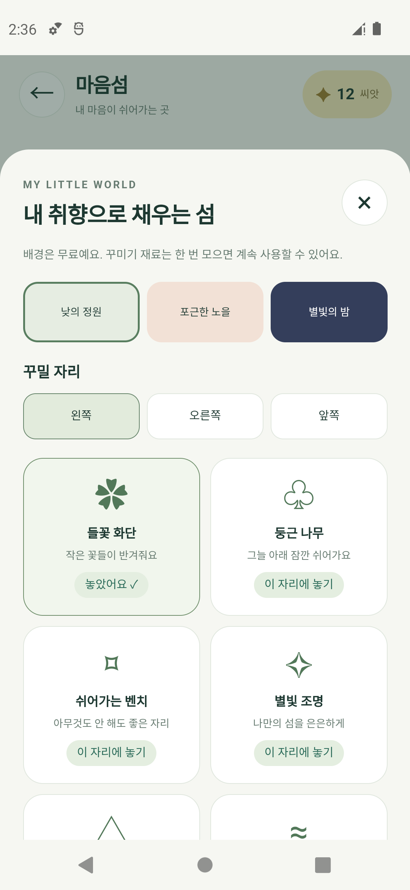</td><td>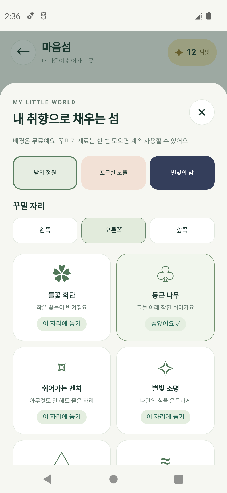</td></tr><tr><td>무료 배경 3종, 배치 자리 3개, 꾸미기 재료 목록.<br/><br/>이미 소유한 재료는 다시 씨앗을 쓰지 않고 배치한다.</td><td>왼쪽·오른쪽·앞쪽 중 현재 선택한 자리가 강조된다.<br/><br/>같은 재료를 다른 자리에 놓으면 기존 자리에서 이동한다. 한 재료를 중복 배치하지 않는다.</td></tr></table>

<table><tr><th>14. 섬 꾸미기 — 목록 하단</th><th>15. 나의 섬 — 별빛의 밤</th></tr><tr><td>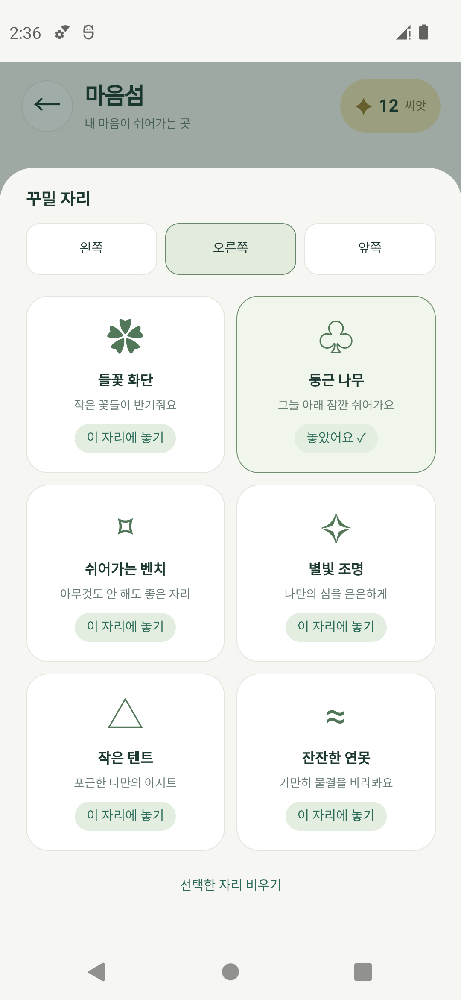</td><td>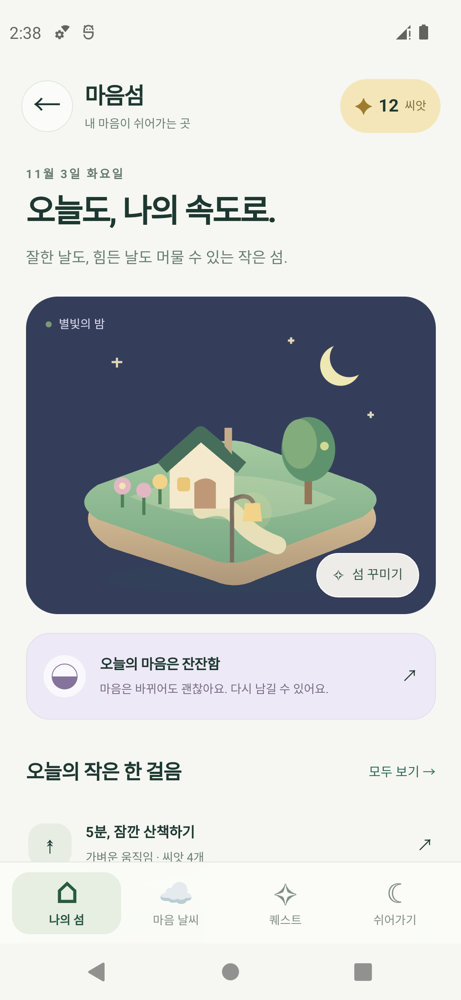</td></tr><tr><td>텐트·연못 등 목록 하단과 선택한 자리 비우기.<br/><br/>자리를 비워도 재료 소유권과 모아둔 씨앗은 유지된다.</td><td>달과 별이 있는 밤 배경. 섬과 배치한 재료는 그대로 유지된다.<br/><br/>배경 변경은 무료다. 기분의 좋고 나쁨에 따라 잠그거나 해제하지 않는다.</td></tr></table>


### 마음 날씨와 기록

<table><tr><th>06. 마음 날씨 — 기록 전</th><th>07. 마음 날씨 — 날씨 선택</th></tr><tr><td>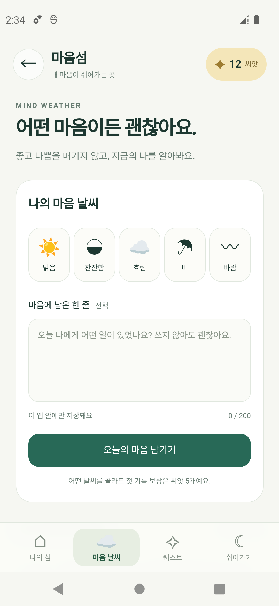</td><td>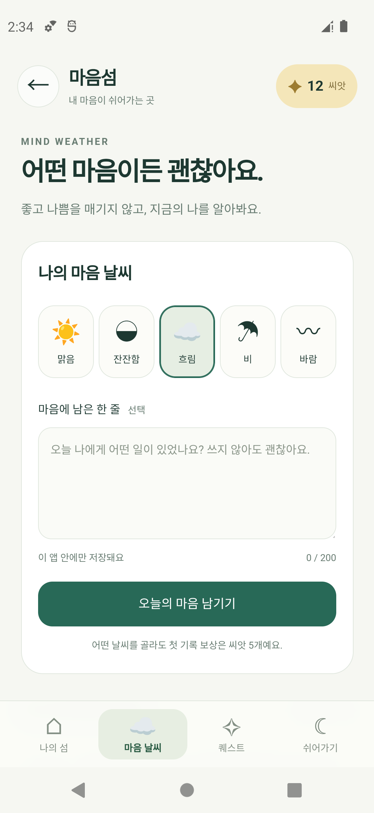</td></tr><tr><td>날씨 5종과 선택 입력 메모. 아직 기록하지 않은 상태.<br/><br/>날씨 선택 없이 저장하면 안내한다. 메모 없이 날씨만 저장할 수도 있다.</td><td>흐림을 선택한 모습. 선택 테두리와 버튼 상태가 바뀐다.<br/><br/>선택만으로 보상을 지급하지 않는다. 저장 버튼을 눌러야 기록과 보상이 확정된다.</td></tr></table>

<table><tr><th>09. 마음 날씨 — 저장 후 수정</th><th>10. 최근 일주일의 마음</th></tr><tr><td>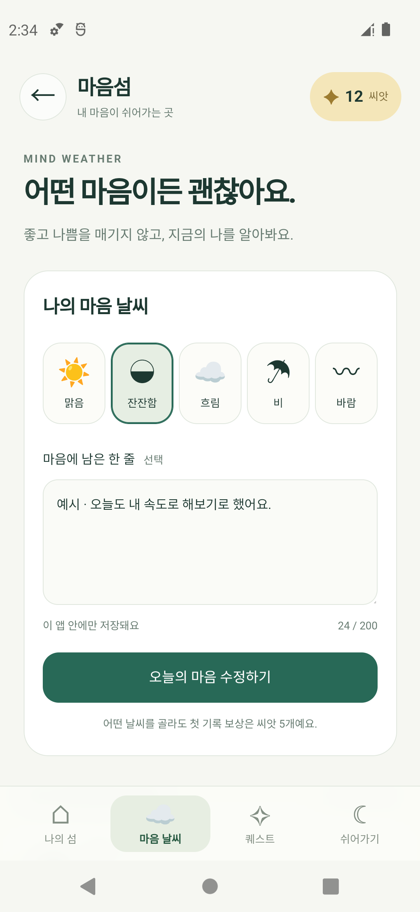</td><td>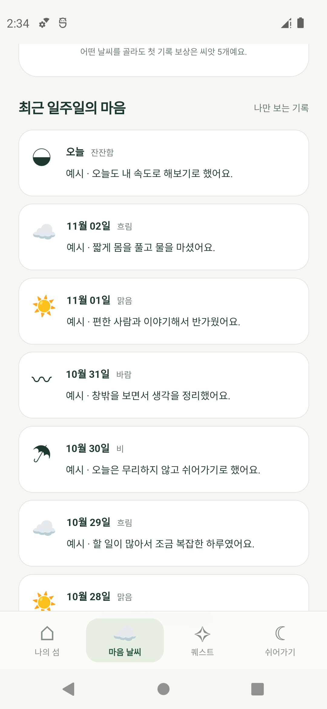</td></tr><tr><td>저장한 날씨와 예시 메모가 입력 칸에 복원된다. 버튼이 수정하기로 바뀐다.<br/><br/>하루 한 날짜에 한 기록을 유지한다. 수정은 가능하지만 첫 기록 보상 5개를 다시 지급하지 않는다.</td><td>날짜별 마음 날씨와 메모가 최신순으로 표시된다.<br/><br/>화면에는 최근 7일을 표시한다. 공개 메모는 모두 예시로 직접 만든 문장이다.</td></tr></table>

<table><tr><th>11. 마음 기록 — 이전 날짜</th></tr><tr><td>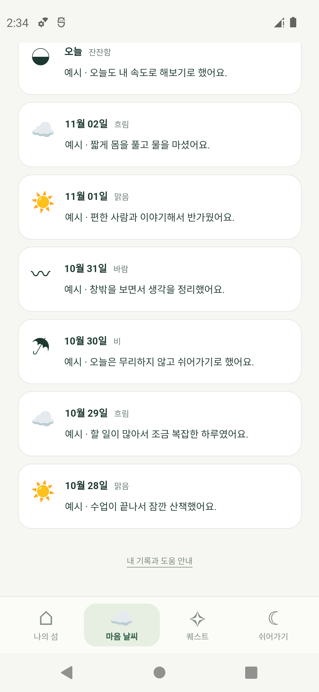</td></tr><tr><td>더 이전 날짜의 예시 기록을 확인하는 모습.<br/><br/>앱 안에 저장한 기록이며 팀원이나 보호자에게 자동 공유되지 않는다.</td></tr></table>


### 작은 퀘스트

<table><tr><th>16. 작은 퀘스트 — 진행 전</th><th>17. 움직임 퀘스트 선택</th></tr><tr><td>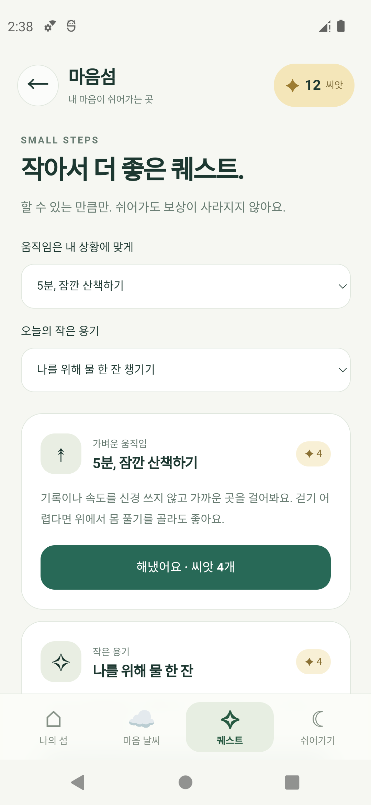</td><td>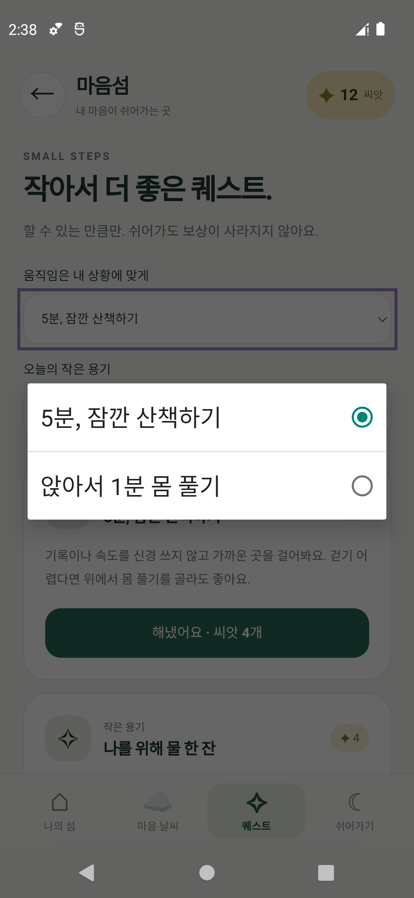</td></tr><tr><td>움직임과 작은 용기를 고르고 세 가지 퀘스트를 확인한다.<br/><br/>워치 센서가 완료를 판정하지 않는다. 활동 후 본인이 해냈어요를 눌러 기록한다.</td><td>5분 산책과 앉아서 1분 몸 풀기 중 선택.<br/><br/>걷기 어려운 상황에서도 같은 보상을 받는 대안을 제공한다.</td></tr></table>

<table><tr><th>18. 작은 용기 선택</th><th>19. 작은 퀘스트 — 완료</th></tr><tr><td>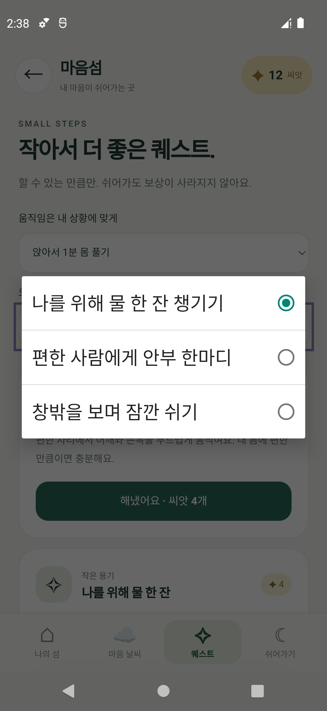</td><td>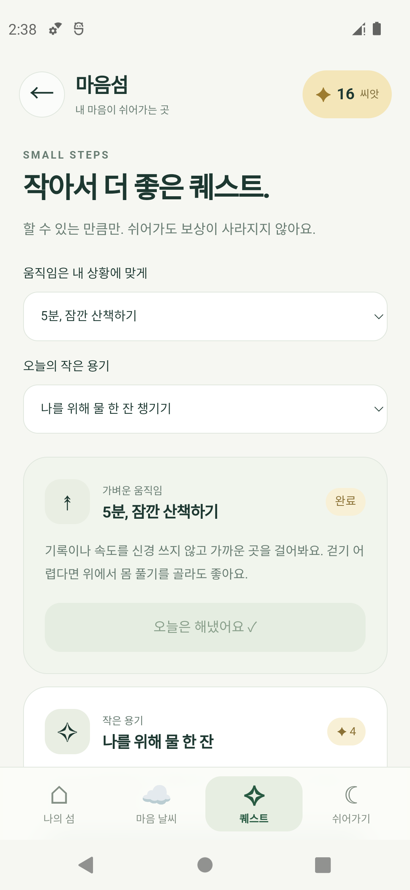</td></tr><tr><td>물 한 잔·편한 사람에게 안부·창밖을 보며 쉬기 중 선택.<br/><br/>연락이나 메시지를 앱이 대신 보내지 않는다. 부담스럽다면 다른 행동을 선택할 수 있다.</td><td>해당 퀘스트가 완료 표시로 바뀌고 버튼이 비활성화된다.<br/><br/>각 퀘스트는 하루 한 번 씨앗 4개를 지급한다. 반복 탭이나 선택 변경으로 중복 지급되지 않는다.</td></tr></table>


### 호흡 게임과 쉼 기록

<table><tr><th>20. 쉬어가기 — 시작 전</th><th>21. 쉬어가기 — 진행 중</th></tr><tr><td>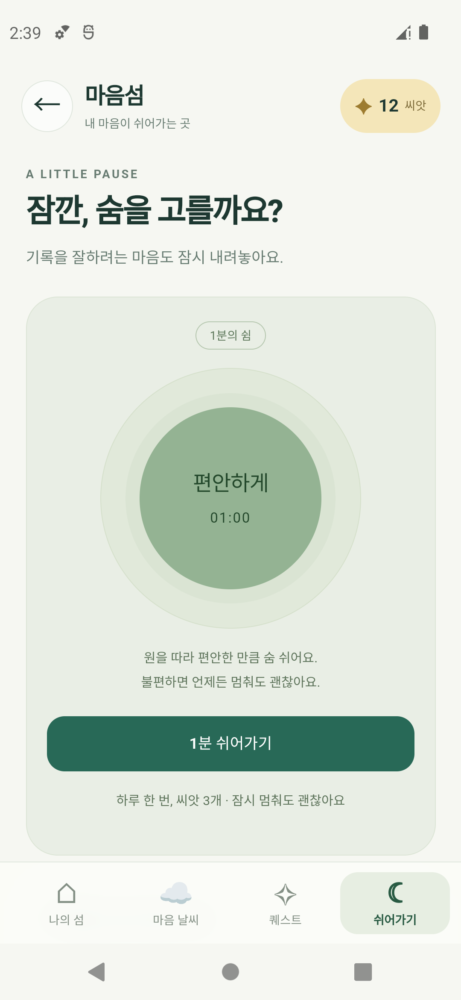</td><td>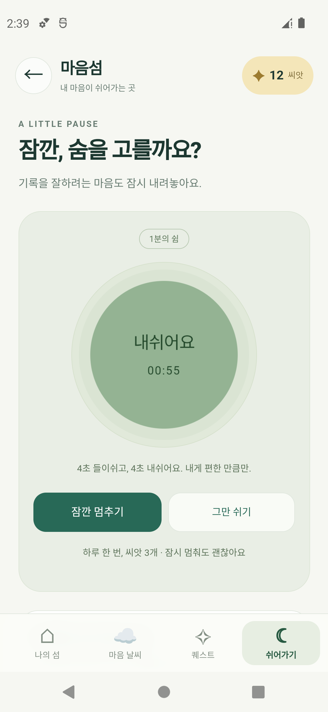</td></tr><tr><td>1분 호흡 안내와 시작 버튼.<br/><br/>치료·진단 화면이 아니다. 편안한 만큼 따라 하고 언제든 멈출 수 있다.</td><td>원의 크기와 문구가 들이쉬기·내쉬기에 맞춰 바뀌고 남은 시간이 줄어든다.<br/><br/>안내는 4초 들이쉬기·4초 내쉬기다. 숨 참기를 요구하지 않는다.</td></tr></table>

<table><tr><th>22. 쉬어가기 — 일시정지</th><th>23. 쉬어가기 — 완료</th></tr><tr><td>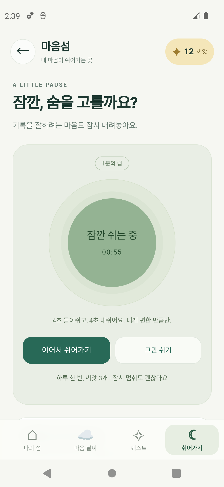</td><td>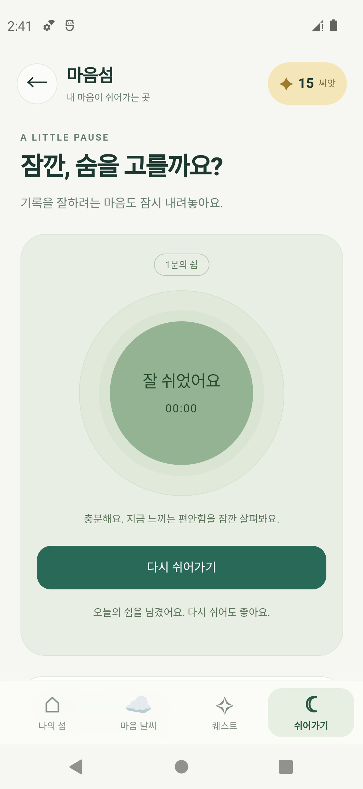</td></tr><tr><td>남은 시간이 멈추고 이어서 쉬어가기 버튼이 표시된다.<br/><br/>탭 이동·백그라운드 전환 때도 일시정지한다. 멈춘 동안의 시간을 완료 시간에 넣지 않는다.</td><td>잘 쉬었어요와 00:00, 다시 쉬어가기 안내.<br/><br/>하루 첫 완료만 씨앗 3개를 받는다. 이후에도 보상 없이 쉬어갈 수 있다.</td></tr></table>

<table><tr><th>24. 내가 느낀 쉼</th></tr><tr><td>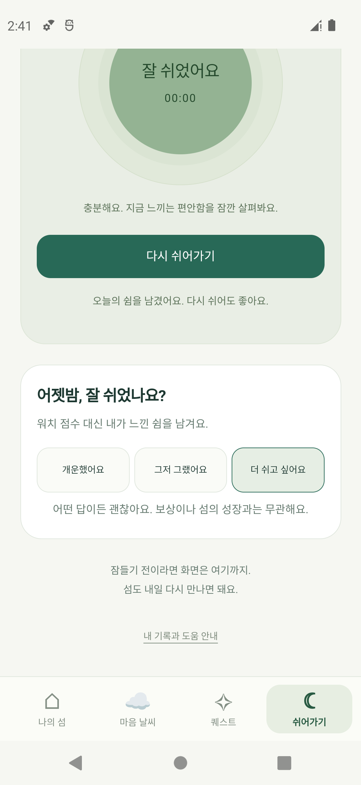</td></tr><tr><td>개운함·그저 그랬음·더 쉬고 싶음 중 주관적인 느낌을 기록한다.<br/><br/>워치 수면 점수와 별개이며 점수·씨앗·섬의 성장에 영향을 주지 않는다.</td></tr></table>


### 기록 안내와 삭제

<table><tr><th>25. 내 기록과 도움 안내</th><th>26. 마음·쉼 기록 삭제 확인</th></tr><tr><td>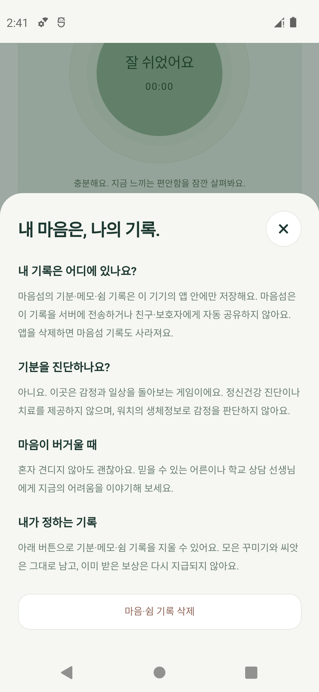</td><td>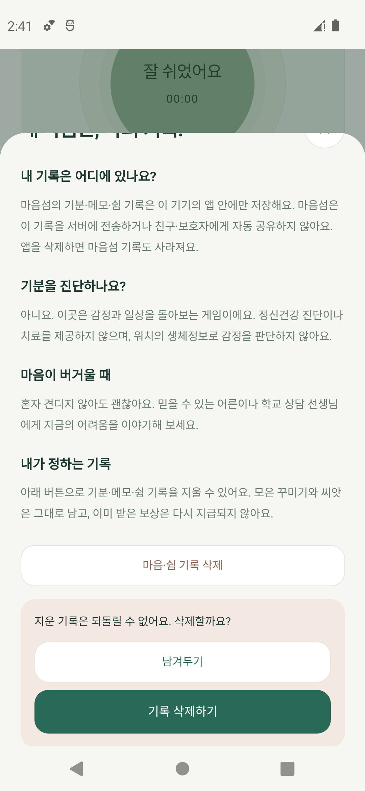</td></tr><tr><td>저장 위치, 모듈의 데이터 전송 범위, 진단 아님, 도움 요청과 삭제 안내.<br/><br/>이 모듈의 기록 정책이다. 기존 제조사 앱과 타사 SDK 전체의 통신 정책을 대신하지 않는다.</td><td>되돌릴 수 없다는 설명과 남겨두기·기록 삭제하기 버튼.<br/><br/>확인 전에는 삭제하지 않는다. 삭제 대상은 마음 날씨·메모·주관적 쉼 기록이다.</td></tr></table>

<table><tr><th>27. 기록 삭제 후 빈 상태</th></tr><tr><td>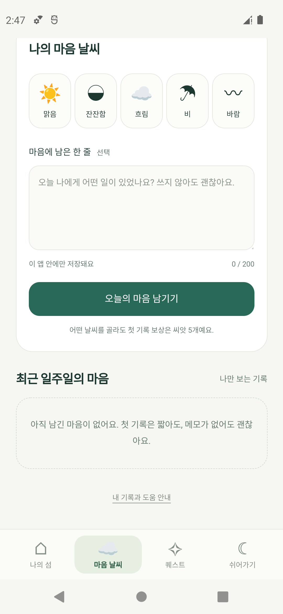</td></tr><tr><td>기록이 없는 히스토리 안내.<br/><br/>꾸미기·씨앗·기지급 보상 이력은 남는다. 지운 뒤 같은 날짜 기록을 다시 써도 보상을 재지급하지 않는다.</td></tr></table>

## 게임 규칙과 데이터

### 씨앗과 꾸미기

| 항목 | 규칙 |
| --- | --- |
| 첫 시작 | 씨앗 12개 |
| 마음 날씨 첫 기록 | 날짜당 5개. 같은 날 수정은 보상 없음 |
| 움직임·작은 용기·휴식 퀘스트 | 각 4개 × 3종, 날짜당 각 한 번 |
| 호흡 60초 완료 | 날짜당 3개, 재실행·재완료 보상 없음 |
| 날짜당 새 보상 상한 | 위 활동을 모두 하면 20개. 별도 출석 보상은 없음 |
| 판정 날짜 | 기기의 현지 날짜. 테스트 에뮬레이터는 `Asia/Seoul` |
| 배경 | 낮의 정원·포근한 노을·별빛의 밤, 전부 무료 |
| 배치 | 왼쪽·오른쪽·앞쪽 3자리. 같은 재료는 한 자리만 차지함 |
| 쉬어가는 날 | 씨앗 차감·꾸미기 소멸·연속 출석 실패 벌점 없음 |

| 꾸미기 | 씨앗 비용 | 한 번 소유한 뒤 |
| --- | ---: | --- |
| 들꽃 화단 | 5 | 재배치 무료 |
| 둥근 나무 | 6 | 재배치 무료 |
| 쉬어가는 벤치 | 8 | 재배치 무료 |
| 별빛 조명 | 8 | 재배치 무료 |
| 작은 텐트 | 10 | 재배치 무료 |
| 잔잔한 연못 | 10 | 재배치 무료 |

유료 결제, 확률형 보상, 순위표, 연속 접속 압박을 넣지 않았습니다. 긍정적인 감정을 골라야 더 많은 보상을 받는 구조도 아닙니다. 움직임 퀘스트는 산책 대신 **앉아서 몸 풀기**를 선택해도 같은 보상을 받습니다.

### 기록 보관과 삭제

- 마음섬 상태는 앱 전용 `getNoBackupFilesDir()/mind-island-v1.json`에 저장합니다.
- `AtomicFile`로 기록하며 읽기에 실패하면 기존 파일을 덮어쓰지 않고 저장 중단 안내를 표시합니다. 쓰기 실패 시 변경을 확정하지 않습니다.
- 마음·보상·쉼·행동 선택은 각 최대 180개 날짜를 유지합니다. 마음 화면에는 **최근 7일**을 최신순으로 표시합니다.
- 삭제 확인은 마음 날씨·메모·주관적 쉼을 제거합니다. 꾸미기·씨앗과 이미 지급한 날짜별 보상 이력은 남겨 중복 보상을 막습니다.
- 마음섬의 기록은 서버에 전송하거나 자동 공유하지 않습니다. 앱 삭제 시 제거되며 이 파일은 클라우드 백업 대상으로 사용하지 않습니다.
- **기존 제조사 앱과 타사 SDK 전체를 오프라인 앱으로 바꾼 것은 아닙니다.** 위 정책은 새 마음섬 모듈에 관한 것입니다.

### 1분 호흡의 시간 처리

실제로 화면에서 진행한 시간을 누적합니다. 4초 들이쉬기·4초 내쉬기의 시각 안내를 반복하고, 60초가 되면 완료합니다. 다른 탭이나 백그라운드로 이동하면 일시정지하며, 사용자 선택으로 이어갑니다. 긴 프레임 간격(2초 초과)이 생겨도 자동 일시정지해 화면 밖의 시간을 완료 시간에 더하지 않습니다. 애니메이션 최소화 환경을 위한 `prefers-reduced-motion` 스타일도 포함합니다. 진행 중 앱 프로세스가 종료되면 타이머 진행 자체는 복원하지 않습니다. 이미 저장한 완료 보상 이력은 유지합니다.

## 구조와 소스 위치

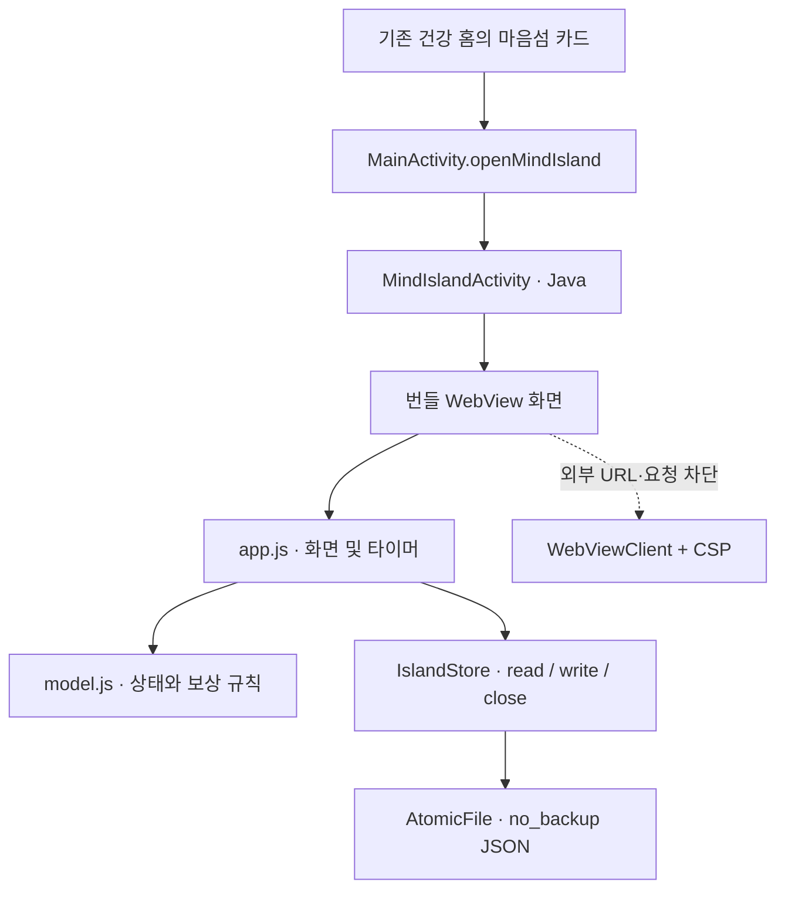

| 경로 | 역할 / 수정할 때 |
| --- | --- |
| [`features/mind-island/src/`](features/mind-island/src/) | 새 Java Activity, WebView 제한, 원자적 저장. 네이티브 기능 수정 |
| [`index.html`](patches/base/assets/mind-island/index.html) | 마음섬 화면 구조·한국어 안내·접근성 라벨 |
| [`style.css`](patches/base/assets/mind-island/style.css) | 카드·섬·모달·하단 탭·호흡 애니메이션·반응형 스타일 |
| [`app.js`](patches/base/assets/mind-island/app.js) | 화면 전환, 입력, SVG 풍경, 꾸미기 상점, 실제 타이머 |
| [`model.js`](patches/base/assets/mind-island/model.js) | 데이터 정규화, 날짜, 보상, 소유권·배치, 기록 삭제 |
| [`v2_status_item_step.xml`](patches/base/res/layout/v2_status_item_step.xml) | 기존 건강 홈과 마음섬 진입 카드 |
| [`MainActivity.smali`](patches/base/smali_classes19/com/sma/smartv3/ui/main/MainActivity.smali) | 기존 앱에서 새 Activity를 여는 메서드 |
| [`AndroidManifest.xml`](patches/base/AndroidManifest.xml) | 새 Activity 등록. Activity는 외부 공개하지 않음 |
| [`profiles/diz-sw01-mind-island.json`](profiles/diz-sw01-mind-island.json) | 앱 이름·ID·버전·APK 파일명 |
| [`tests/mind-island-model.test.cjs`](tests/mind-island-model.test.cjs) | 순수 모델의 15개 검증 |
| [`patches/base/`](patches/base/) | 기존 앱 Smali·XML·리소스 오버레이. 실제 기존 앱 수정 위치 |
| [`reference-java/`](reference-java/) / [`linear-reference-java/`](linear-reference-java/) | 복원 Java 참고 자료. 직접 수정해도 APK에 반영되지 않음 |
| [`scripts/`](scripts/) | 작업 공간 복원·추출·오버레이·컴파일·재조립·서명·캡처 |
| `workspace/`, `.downloads/`, `dist/` | 로컬 생성물. Git 제외 |

### 빌드가 반영되는 과정

1. `Compile-MindIsland.ps1`이 새 Java 소스를 컴파일하고 D8로 **DEX 20**을 생성합니다.
2. 생성한 `patches/base/classes20.dex`는 Git에서 제외하며 빌드 때 재생성합니다.
3. `ApplyOverlay.py`가 변경된 Smali·리소스·게임 assets·DEX를 전체 복원 작업 공간에 반영합니다.
4. Apktool로 기준 분할 APK를 재조립하고 `PrepareStandalone.py`가 리소스와 ARM64 라이브러리를 통합합니다.
5. `ApplyIdentity.py`가 프로필의 앱 ID·표시 이름·버전·Provider·자체 권한 식별자를 적용합니다.
6. 단일 APK를 조립·정렬한 뒤 로컬 테스트 키로 서명하고 검증합니다.

기존 앱의 DEX 중 진입 메서드를 추가한 `classes19.dex`가 변경되고, 새 모듈은 `classes20.dex`로 추가됩니다. 0.3.0 검증에서는 **네이티브 라이브러리 50개의 원래 바이트가 유지**되었습니다. 기존 Bluetooth 프로토콜과 계정 로직을 검증·개선했다는 뜻은 아닙니다.

## 빠른 실행·빌드

### 준비물

| 도구 | 용도 |
| --- | --- |
| Windows PowerShell | 저장소의 빌드 래퍼 실행 |
| Git | 저장소 받기. Windows에서는 이 저장소에 `core.longpaths=true` 사용 |
| Python 3.8 이상 | 압축 해제·오버레이·통합·앱 식별자 적용·화면 캡처 |
| Java 17 이상 / Android Studio JBR | Java·DEX·Apktool·서명 도구 실행. 이 PC는 JBR 25로 검증 |
| Android SDK platform 35 | 새 Java Activity 컴파일용 `android.jar` |
| Android SDK build-tools 35.0.0 | 새 모듈을 DEX로 변환하는 D8 |
| Platform-Tools, Emulator, API 31 Google APIs 이미지 | adb와 가상 기기 실행 |
| Node.js 18 이상 | 모델 테스트용. APK 실행에는 필요 없음 |

GitHub CLI는 현재 복원 스크립트의 필수 도구가 아닙니다. 기준 작업 공간은 PowerShell로 공개 Release에서 받고 고정 SHA-256을 검사합니다.

### 1. 짧은 경로에 저장소 받기

아래는 예시 경로입니다. `C:\src`에 쓰기 권한이 없으면 본인이 쓸 수 있는 짧은 경로로 바꾸세요.

```powershell
git -c core.longpaths=true clone https://github.com/HyelimPark77/custom_smart-time-pro.git C:\src\diz
cd C:\src\diz
git config core.longpaths true
```

### 2. 현재 PowerShell 세션에 도구 경로 설정

```powershell
$env:JAVA_HOME = 'C:\Program Files\Android\Android Studio\jbr'
$env:ANDROID_HOME = "$env:LOCALAPPDATA\Android\Sdk"
$env:PATH = "$env:JAVA_HOME\bin;$env:ANDROID_HOME\platform-tools;$env:PATH"
java -version
python --version
```

Android Studio SDK Manager에서 아래 패키지를 설치하거나 명령행 도구가 설치돼 있으면 다음을 실행합니다. 라이선스 화면은 직접 확인합니다.

```powershell
& "$env:ANDROID_HOME\cmdline-tools\latest\bin\sdkmanager.bat" `
  'platforms;android-35' 'build-tools;35.0.0' 'platform-tools' 'emulator' `
  'system-images;android-31;google_apis;x86_64'
```

기준 APK의 매니페스트는 minSdk 26 / targetSdk 36을 유지합니다. **SDK platform 35는 새 모듈의 Java 컴파일용**입니다. 실제 확인한 가상 기기는 API 31이며, 구형 WebView·다른 API·실기기의 동작까지 보장하지 않습니다.

### 3. 전체 복원 작업 공간 받기

```powershell
# 약 525 MB의 기준 작업 공간 ZIP을 받고 고정 SHA-256을 검사한 뒤 풉니다.
.\scripts\Restore-Workspace.ps1 -DestinationRoot 'C:\diz-work'
$env:SMART_TIME_WORKSPACE = 'C:\diz-work\SMART_TIME_PRO_customization'
```

복원 원본은 이 포크의 0.3.0 Release가 아니라 [상위 저장소의 고정 기준 Release](https://github.com/dlwlsrnjs/custom_smart-time-pro/releases/tag/analysis-v2.1.3.4-baseline)입니다. 여기에 이 저장소의 변경 사항을 오버레이합니다.

기준 `customization-workspace.zip`의 SHA-256:

```text
c6cf98d0cfadb9eebde48e19c8cbedd7954abd7c35f98801dc240a9b6448461b
```

이미 받아둔 기준 ZIP이 있다면 `-ArchivePath 'D:\downloads\customization-workspace.zip'`을 함께 지정할 수 있습니다. 기존 작업 공간이 있으면 덮어쓰지 않습니다. Windows 긴 경로를 지원하는 별도 추출 도구를 사용합니다. `SMART_TIME_WORKSPACE`는 **압축을 푼 부모 폴더가 아니라 `SMART_TIME_PRO_customization` 폴더 자체**를 가리켜야 합니다.

### 4. 마음섬 0.3.0 APK 빌드

```powershell
.\scripts\Build.ps1 -IdentityProfile .\profiles\diz-sw01-teen-ui.json
```

결과:

```text
dist/Diz_SW01_Teen_UI_0.6.0_ARM64_TEST.apk
```

이 저장소에 APK를 일반 Git 파일로 넣지 않습니다. GitHub 소스만 clone하면 APK와 전체 기준 작업 공간이 함께 내려오는 구성이 아닙니다. 현재 팀 공유 기준은 **소스 + 화면 + 재현 가능한 빌드 절차**입니다. 이 포크에 새 APK Release가 게시되었다고 가정하는 다운로드 링크도 넣지 않았습니다.

처음 빌드하면 작업 공간에 개발용 `test-only.jks`가 생성됩니다. 개발자마다 새 키를 생성하면 같은 앱 ID라도 서로 업데이트 설치할 수 없습니다. 키는 Git에 올리지 않고, 팀 테스트 단말의 실제 데이터를 지우는 방식으로 해결하지 않습니다. 상세한 서명·설치 제약은 [BUILD](docs/BUILD.md)와 [TESTING](docs/TESTING.md)을 보세요.

### 5. 에뮬레이터에서 실행

Android Studio Device Manager에서 **API 31 Google APIs x86_64** 가상 기기를 만들고 켭니다. 다음 명령으로 확인합니다.

```powershell
.\scripts\Check-Emulator.ps1 -SdkRoot $env:ANDROID_HOME
adb devices -l

# 실제 출력에 나온 일련번호로 바꾸세요.
$serial = 'emulator-5554'
adb -s $serial shell getprop ro.product.cpu.abilist
adb -s $serial install -r .\dist\Diz_SW01_Teen_UI_0.6.0_ARM64_TEST.apk
adb -s $serial shell am start -W -n `
  com.diz.sw01.custom.ui/com.sma.smartv3.ui.launcher.LauncherActivity
```

이 APK에는 ARM64 네이티브 라이브러리가 있습니다. x86_64 가상 기기라면 ABI 목록에 `arm64-v8a` 지원이 표시되는 이미지인지 확인해야 합니다. 이 PC의 API 31 Google APIs 이미지에서는 `x86_64,arm64-v8a`가 확인됐지만 모든 이미지가 같은 것은 아닙니다.

첫 실행 시 기존 앱 안내를 직접 확인하고 데모용 초기 정보를 입력합니다. 워치 연결 단계에서는 **나중에 추가**로 이동한 뒤 건강 홈의 **마음섬** 카드를 누릅니다. 마음섬 사용 자체에는 제조사 계정 로그인이나 워치가 필요하지 않습니다.

### 6. 현재 UI 미리보기의 온라인 제약

원 제조사 서버의 강제 업데이트 안내가 화면을 가리는 현상이 확인됐습니다. 이는 아직 수정하지 않았습니다. 이번 UI·게임 점검은 **에뮬레이터를 오프라인으로 둔 상태**에서 했습니다. 테스트용 에뮬레이터에서 같은 조건을 재현하려면:

```powershell
adb -s $serial shell svc wifi disable
adb -s $serial shell svc data disable
adb -s $serial shell am force-stop com.diz.sw01.custom.ui
adb -s $serial shell am start -W -n `
  com.diz.sw01.custom.ui/com.sma.smartv3.ui.launcher.LauncherActivity

# 테스트 후 인터넷을 복원할 때
adb -s $serial shell svc wifi enable
adb -s $serial shell svc data enable
```

이 조치는 게스트 Android의 Wi-Fi·데이터 상태만 바꾸며, 실제 워치 Bluetooth 연결을 구현하는 조치가 아닙니다.

## 테스트와 검증 범위

### 모델 테스트 실행

```powershell
node .\tests\mind-island-model.test.cjs
# 기대 결과: 15 mind-island model checks passed.
```

검사 항목은 초기 상태, 날씨별 동일 보상, 당일 수정·반복 보상 방지, 다음 날짜 보상, 퀘스트별 중복 방지, 호흡 완료 조건, 재료 구입·재배치·자금 부족·자리 비우기, 기록 삭제 후 보상 이력 유지, 쉼 무점수 처리, 메모 길이, 잘못된 상태 정규화, 날짜 보관 수와 현지 날짜입니다.

### 실제 확인한 것

| 항목 | 결과 / 범위 |
| --- | --- |
| APK 조립·서명·정렬 | Apktool 빌드, v2·v3 서명 검증, ZIP 정렬 검사 통과 |
| 설치 | 기존 0.2.0 앱 위에 같은 로컬 키로 0.3.0 업데이트 설치 성공. 제거하지 않음 |
| 건강 홈 → 게임 | 실제 카드 클릭으로 새 Activity 진입 확인 |
| 기분 기록 | 날씨·메모 저장, 12→17 보상, 당일 재저장 시 17 유지 |
| 꾸미기 | 재료 구입 2종, 자리 배치, 배경 변경이 상태 파일에 반영됨 |
| 재실행 | 앱 강제 종료 후 기분·메모·소유 재료·배치·씨앗·배경 복원 확인 |
| 호흡 | 일시정지한 5초 동안 동일 화면, 이어서 실제 누적 60초 완료 후 3개 지급 확인 |
| 퀘스트 | 앉아서 몸 풀기 대안 선택, 완료·중복 탭 보상 한 번 확인 |
| 쉼 | 주관적 쉼 선택이 저장되며 씨앗은 바뀌지 않음 |
| 삭제 | 확인 후 마음·메모·쉼만 제거되고 재료·씨앗·보상 이력 유지 |
| 바이너리 범위 | 기존 DEX 19 변경 + DEX 20 추가, 네이티브 라이브러리 50개 바이트 유지 |
| 저장 경로 | 앱 전용 no-backup JSON 사용. 테스트 샘플은 검증 후 원래 시작 상태로 복원 |
| 복원 도구 | 긴 경로 추출, 기존 작업 공간 덮어쓰기 거부, 경로 이탈 ZIP 거부 스모크 검사 |

상세 산출물: [0.3.0 검증 기록](analysis/mind-island-verification.json). 서명·정렬 통과는 악성코드 안전성 판정이나 실기기 설치 승인을 뜻하지 않습니다.

### 아직 검증하지 않은 것

실물 Diz-SW01의 검색·인증·연결·시간 동기화, 제조사 서버 로그인, 실기기 설치 차단 해소, 장기 사용, 다양한 WebView·Android 버전, 실제 청소년 대상 사용성·정신건강 효과는 확인하지 않았습니다. 연구기관의 기존 연구를 이 앱의 임상 검증처럼 제시하지 않습니다.

## 알려진 제약과 다음 작업

| 우선순위 | 항목 | 다음 확인 / 완료 기준 |
| --- | --- | --- |
| P0 | 커스텀 업데이트 채널 | 0.5.0 자동 제조사 검사는 분리. 설정 수동 검사와 커스텀 릴리스 안내를 정리 |
| P0 | 실기기 설치 차단 조사 | 기존 삼성 차단 기록·권한·서명·네이티브 호환성을 검토. 0.3.0 안전 판정 완료로 표시하지 않음 |
| P1 | 실제 워치 연결 | 원 앱과 같은 조건에서 검색·인증·연결·동기화 로그를 확보한 뒤 SDK 경로 검증 |
| P1 | 게임과 건강 데이터 연결 검증 확대 | 0.6.0 읽기 전용 연결 구현. 실제 추가 300걸음 완료와 수면 기록 표시의 실물 검증 확대 |
| P1 | 청소년 사용성 검토 | 연령에 맞는 표현, 접근성, 개인정보 설명, 보호자·상담자와의 공유 동의 흐름을 검토 |
| P2 | 안정성·보관 정책 | 장기 기록, 날짜 변경, 저장 실패, Android/WebView 버전별 회귀 테스트 |
| P2 | 독립 앱 전환 검토 | 제조사 서버·SDK·배포 권리 의존을 분리한 정식 소스 프로젝트 방향 결정 |

기존 Galaxy S25 설치 차단과 네이티브 ELF 정렬 문제는 [SECURITY_BLOCK](docs/SECURITY_BLOCK.md), [INSTALLATION_AUDIT](docs/INSTALLATION_AUDIT.md), [DEVICE_BLOCK_DIAGNOSIS](docs/DEVICE_BLOCK_DIAGNOSIS.md)에 근거를 남겼습니다. 과거 0.1.0 차단과 0.3.0 에뮬레이터 실행은 서로 다른 검증 사실입니다.

## 협업·문서·원본 자료

| 문서 | 읽는 목적 |
| --- | --- |
| [화면 명세서](docs/SCREENS.md) | 27개 화면의 진입 경로·상태·버튼·저장 의미 |
| [팀 작업 안내](docs/TEAM_GUIDE.md) | 역할별 수정 위치, 브랜치·테스트·캡처 갱신 절차 |
| [마음섬 기술 문서](docs/MIND_ISLAND.md) | 새 기능의 구현·저장·네이티브 연결 |
| [기존 게임 기능 인수인계](docs/HANDOFF.md) | 이번 버전 상태와 다음 담당자의 시작 지점 |
| [APK 빌드](docs/BUILD.md) | 복원→오버레이→DEX→통합→서명 세부 절차 |
| [에뮬레이터](docs/EMULATOR.md) | 실행 준비·ABI·Bluetooth 검증 범위 |
| [한국어 UI 변경](docs/KOREAN_UI.md) | 0.2.0 UI 시안과 후속 변경의 출발점 |
| [기존 25개 수정 영역](docs/CUSTOMIZATION.md) | 원 앱의 화면·설정·SDK 수정 위치 |
| [복원 범위와 한계](docs/RECOVERY.md) | 읽기용 Java·Smali·원본 소스의 차이 |
| [기준 복원 README 보관](BASELINE.md) | 2026-11-02 기준 APK와 상위 Release 기록 |

게임 디자인의 참고 방향은 [WHO의 청소년 정신건강 자료](https://www.who.int/news-room/fact-sheets/detail/adolescent-mental-health)와 [UNICEF RITEC](https://www.unicef.org/innovation/responsible-innovation-technology-children-ritec)의 감정 인식·일상 습관·선택권·창의성입니다. 이 기관들이 이 앱을 평가하거나 효과를 입증한 것은 아닙니다.

기존 앱·SDK·이미지·콘텐츠의 권리는 각 권리자에게 있습니다. 복원 자료가 원 앱 전체의 재배포·상용 이용 권한을 부여하지 않습니다. 임의로 원 앱 전체에 새 오픈소스 라이선스를 부여하지 않았습니다. APK·원본 작업 공간·서명 키·실사용 감정 기록·개인 계정 화면은 일반 소스 커밋에 넣지 않습니다.
