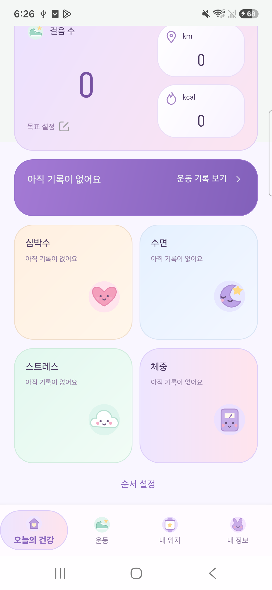
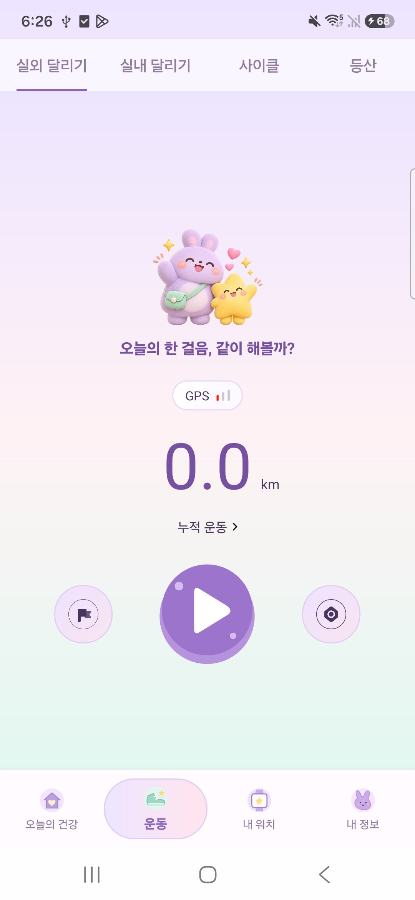
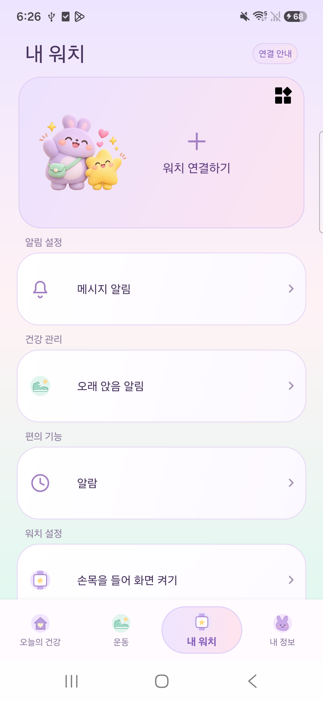
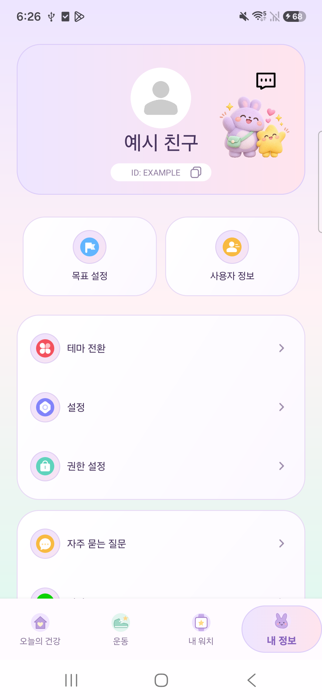
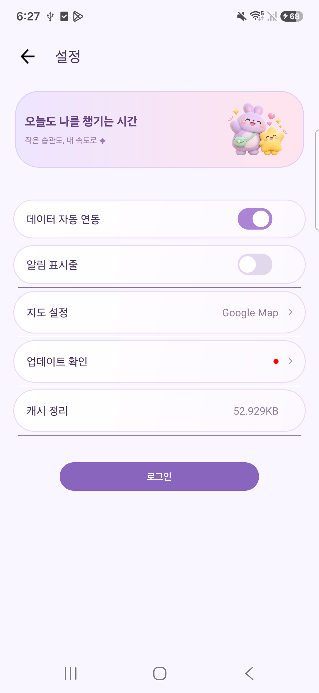
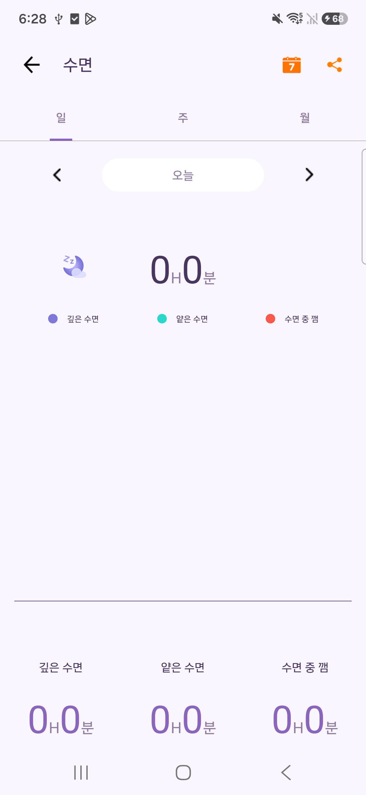

# 앱 전체 공통 테마 — 0.5.0

마음섬에만 캐릭터를 적용했던 0.4.0에서 범위를 넓혀, 기존 앱의 건강·운동·내 워치·내 정보·설정과 공통 상세 화면에 같은 디자인 규칙을 적용했습니다.

## 화면별 변경

| 화면 | 적용 내용 |
| --- | --- |
| 건강 | 라벤더 걸음 카드, 항목별 민트·복숭아·하늘색 카드, 표정 있는 심장·달·구름·체중계 아이콘, 보라색 기록 버튼 |
| 운동 | 회색 장식 배경 제거, 토끼·별 응원 영역, 파스텔 배경과 보라색 시작 버튼·목표·설정 버튼 |
| 내 워치 | 캐릭터 연결 카드, 라벤더 연결 안내와 아이콘·공통 기능 카드 |
| 내 정보 | 캐릭터 프로필 카드, 둥근 목표·사용자 정보 버튼, 파스텔 아이콘과 설정 목록 |
| 설정·사용자 정보·운동 설정 | 캐릭터 안내 배너, 여백 있는 카드형 행, 보라색 스위치·버튼 |
| 건강 상세·기타 기존 화면 | 공통 배경·제목·보조 문구·카드·강조 색상. 실제 측정값·차트의 의미와 바인딩 유지 |
| 시작·로그인·마음섬 | 0.4.0의 캐릭터·파스텔 디자인 유지 |
| 하단 메뉴 | 집·운동화·워치·토끼 스티커 아이콘과 선택 배경 |

## 구현 위치

- `res/values/colors.xml`: 기본·라이트·다크 스킨의 공통 색상.
- `res/values/styles.xml`: 제목·설정 행·건강 카드·운동 컨트롤 등 공유 스타일.
- `res/drawable/diz_*.xml`: 둥근 카드·스위치·스티커 벡터·시작 버튼.
- `res/layout/v2_*`, `fragment_gps_sport*`, `layout_gps_common*`: 기존 네 개 탭과 건강 카드·운동 화면.
- `res/layout/diz_companion_banner.xml`: 설정 등 기존 상세 화면의 공통 캐릭터 배너.

위 경로는 `patches/base/` 기준입니다. 캐릭터 PNG는 [0.4.0 이미지·프롬프트 기록](TEEN_UI.md#캐릭터-이미지)을 재사용합니다. 기존 코드 기반 벡터 아이콘은 같은 팔레트로 새로 그렸습니다.

## 빌드와 변경 범위

```powershell
.\scripts\Build.ps1 -IdentityProfile .\profiles\diz-sw01-teen-ui.json
```

결과: `dist/Diz_SW01_Teen_UI_0.5.0_ARM64_TEST.apk`. 패키지·서명 키·저장 형식은 유지하며 앱을 제거하지 않고 업데이트합니다.

공통 테마 적용과 각 화면의 런타임 확인 범위는 구분합니다. 원 앱의 모든 Activity와 타사 SDK·지도·시스템 권한 창을 새로 구현하거나 전수 검증했다는 뜻은 아닙니다. 실제 측정값·계정·워치 연결·운동 기록 처리 로직을 변경하지 않습니다. 0.5.0에서는 com.diz.sw01.custom.ui에 한해 BaseMainActivity의 원 제조사 자동 앱 버전 검사를 제외했습니다. 다른 패키지의 기존 검사 경로와 워치 펌웨어 경로는 그대로입니다. 설정의 수동 업데이트 메뉴와 별도 커스텀 배포 채널 안내는 후속 정리가 필요합니다.

## 실제 폰 확인 화면

2026-11-03 Galaxy S25 / Android 16에서 업데이트 설치했습니다. 프로필 캡처는 임시 계측 도구로 닉네임·ID 표시만 예시로 바꾸고 성별 표시는 숨겼습니다. 계정 저장값을 바꾸지 않았고 촬영 후 도구를 제거했습니다. 건강 데이터는 빈 상태입니다.

<table><tr><th>건강</th><th>운동</th></tr><tr><td></td><td></td></tr></table>
<table><tr><th>내 워치</th><th>내 정보 · 예시</th></tr><tr><td></td><td></td></tr></table>
<table><tr><th>설정</th><th>수면 상세</th></tr><tr><td></td><td></td></tr></table>

## 검증

변경 XML 파싱과 기존 view ID·onClick 연결 보존, 전체 리소스 컴파일, 서명 v2·v3·ZIP 정렬을 확인했습니다. 온라인 실행에서 강제 제조사 안내 없이 주요 탭 이동을 확인했습니다. 네이티브 라이브러리 50개와 게임 모델은 유지합니다. 수정 DEX19는 원래와 같은 7,311개 클래스와 DEX038 형식을 유지합니다.

조립 중 발견한 클래스 누락·DEX 형식 오류는 최종본에서 수정했으며, 중간 오류 APK를 배포 산출물로 남기지 않았습니다. 최종 검증 파일과 해시는 [검증 JSON](../analysis/teen-ui-0.5.0-verification.json)에 기록했습니다. 실제 폰의 주요 화면 확인과 모든 SDK·다크 모드·워치 기능 검증은 구분합니다.
