# 화면별 기능 명세 · 마음섬 0.3.0

> 2026-11-03 · 실제 API 31 에뮬레이터 PNG. 모든 감정·메모·꾸미기는 설명용 예시 데이터입니다. 실제 청소년의 기록을 사용하지 않았습니다. 주요 탭과 이번 커스텀 범위를 문서화한 것으로, 복원된 원 앱의 모든 세부 Activity를 전수 검증했다는 뜻은 아닙니다.

[README로 돌아가기](../README.md) · [캡처 원본과 SHA-256](screenshots/manifest.json)

## 화면 인덱스

| 번호 | 화면 | 진입 경로 |
| --- | --- | --- |
| 01 | [건강 홈과 마음섬 진입](#screen-01) | 앱 실행 → 오늘의 건강 |
| 02 | [기존 운동 탭](#screen-02) | 하단 운동 |
| 03 | [내 워치](#screen-03) | 하단 내 워치 |
| 04 | [기존 앱 설정](#screen-04) | 내 정보 → 설정 |
| 05 | [나의 섬 — 첫 방문](#screen-05) | 건강 홈 → 마음섬 |
| 06 | [마음 날씨 — 기록 전](#screen-06) | 마음 날씨 탭 |
| 07 | [마음 날씨 — 날씨 선택](#screen-07) | 날씨 버튼 선택 |
| 08 | [나의 섬 — 꾸미기와 오늘의 마음](#screen-08) | 예시 기록과 꾸미기가 있는 나의 섬 |
| 09 | [마음 날씨 — 저장 후 수정](#screen-09) | 마음 날씨 탭 → 기존 오늘 기록 |
| 10 | [최근 일주일의 마음](#screen-10) | 마음 날씨 → 아래로 스크롤 |
| 11 | [마음 기록 — 이전 날짜](#screen-11) | 히스토리 아래로 스크롤 |
| 12 | [섬 꾸미기 — 전체 진입](#screen-12) | 나의 섬 → 섬 꾸미기 또는 씨앗 버튼 |
| 13 | [섬 꾸미기 — 배치 자리 선택](#screen-13) | 꾸밀 자리 → 오른쪽 |
| 14 | [섬 꾸미기 — 목록 하단](#screen-14) | 꾸미기 목록 아래로 스크롤 |
| 15 | [나의 섬 — 별빛의 밤](#screen-15) | 꾸미기 → 별빛의 밤 |
| 16 | [작은 퀘스트 — 진행 전](#screen-16) | 퀘스트 탭 |
| 17 | [움직임 퀘스트 선택](#screen-17) | 움직임 선택 상자 |
| 18 | [작은 용기 선택](#screen-18) | 오늘의 작은 용기 선택 상자 |
| 19 | [작은 퀘스트 — 완료](#screen-19) | 활동 후 해냈어요 |
| 20 | [쉬어가기 — 시작 전](#screen-20) | 쉬어가기 탭 |
| 21 | [쉬어가기 — 진행 중](#screen-21) | 1분 쉬어가기 |
| 22 | [쉬어가기 — 일시정지](#screen-22) | 잠깐 멈추기 |
| 23 | [쉬어가기 — 완료](#screen-23) | 실제 누적 60초 진행 |
| 24 | [내가 느낀 쉼](#screen-24) | 쉬어가기 아래로 스크롤 |
| 25 | [내 기록과 도움 안내](#screen-25) | 화면 아래 → 내 기록과 도움 안내 |
| 26 | [마음·쉼 기록 삭제 확인](#screen-26) | 안내 → 마음·쉼 기록 삭제 |
| 27 | [기록 삭제 후 빈 상태](#screen-27) | 삭제 확인 → 마음 날씨 히스토리 |

## 01. 건강 홈과 마음섬 진입

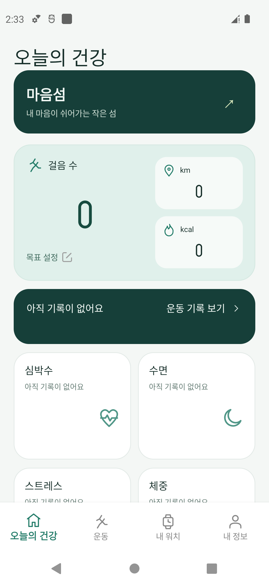

| 항목 | 설명 |
| --- | --- |
| 진입 | 앱 실행 → 오늘의 건강 |
| 표시 상태 | 한국어 건강 카드와 새 마음섬 진입 카드. 걸음·거리·열량은 미연결 상태의 0으로 표시된다. |
| 동작·데이터·검증 범위 | 기존 건강 데이터 화면이며, 마음섬 카드가 새로 추가되었다. |

[화면 인덱스로](#화면-인덱스)

## 02. 기존 운동 탭

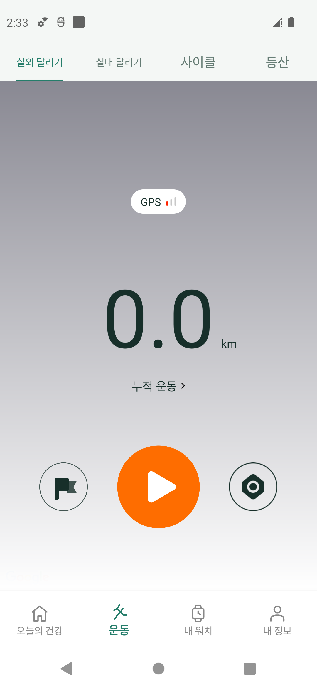

| 항목 | 설명 |
| --- | --- |
| 진입 | 하단 운동 |
| 표시 상태 | 실외·실내 달리기 등 원 앱의 운동 UI. |
| 동작·데이터·검증 범위 | 화면 진입만 확인했다. GPS·운동 기록·워치 실동작 검증 완료를 뜻하지 않는다. |

[화면 인덱스로](#화면-인덱스)

## 03. 내 워치

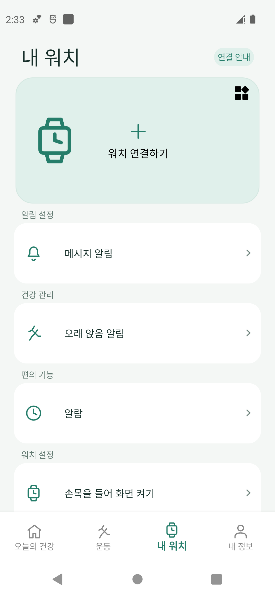

| 항목 | 설명 |
| --- | --- |
| 진입 | 하단 내 워치 |
| 표시 상태 | 워치 연결 카드와 알림·건강 관리·편의 기능 메뉴. |
| 동작·데이터·검증 범위 | Diz-SW01 실제 연결·동기화는 미검증이다. |

[화면 인덱스로](#화면-인덱스)

## 04. 기존 앱 설정

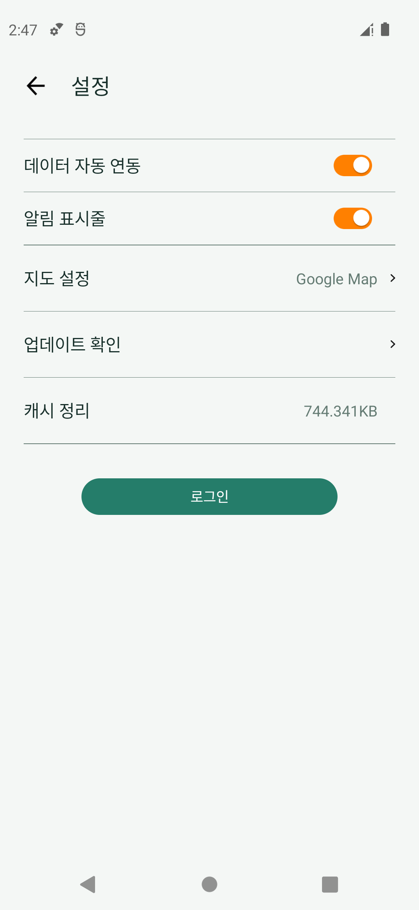

| 항목 | 설명 |
| --- | --- |
| 진입 | 내 정보 → 설정 |
| 표시 상태 | 원 앱의 설정 진입 화면. |
| 동작·데이터·검증 범위 | 프로필 이름·계정 ID가 보이는 내 정보 상단은 공개 캡처에서 제외했다. |

[화면 인덱스로](#화면-인덱스)

## 05. 나의 섬 — 첫 방문

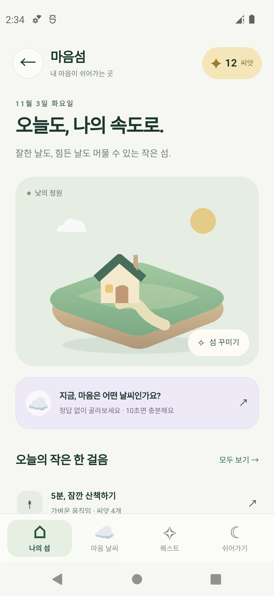

| 항목 | 설명 |
| --- | --- |
| 진입 | 건강 홈 → 마음섬 |
| 표시 상태 | 작은 집이 있는 기본 섬, 시작 씨앗 12개, 마음 기록과 퀘스트로 가는 진입점. |
| 동작·데이터·검증 범위 | 처음에는 꾸미기 소유 목록이 비어 있다. 접속을 쉬어도 섬이 훼손되지 않는다. |

[화면 인덱스로](#화면-인덱스)

## 06. 마음 날씨 — 기록 전

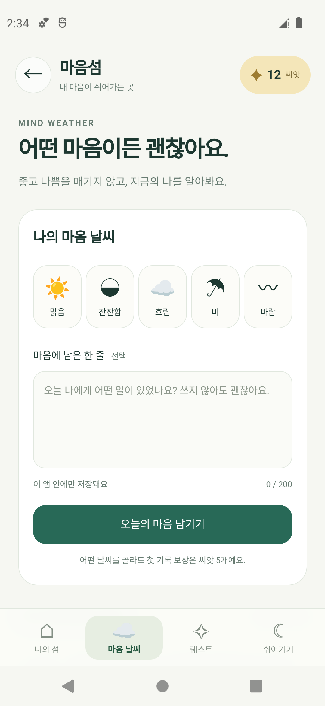

| 항목 | 설명 |
| --- | --- |
| 진입 | 마음 날씨 탭 |
| 표시 상태 | 날씨 5종과 선택 입력 메모. 아직 기록하지 않은 상태. |
| 동작·데이터·검증 범위 | 날씨 선택 없이 저장하면 안내한다. 메모 없이 날씨만 저장할 수도 있다. |

[화면 인덱스로](#화면-인덱스)

## 07. 마음 날씨 — 날씨 선택

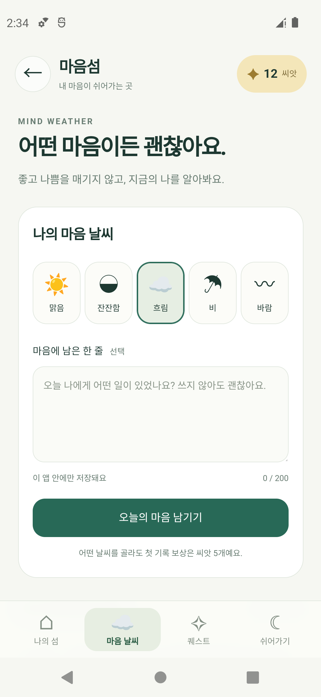

| 항목 | 설명 |
| --- | --- |
| 진입 | 날씨 버튼 선택 |
| 표시 상태 | 흐림을 선택한 모습. 선택 테두리와 버튼 상태가 바뀐다. |
| 동작·데이터·검증 범위 | 선택만으로 보상을 지급하지 않는다. 저장 버튼을 눌러야 기록과 보상이 확정된다. |

[화면 인덱스로](#화면-인덱스)

## 08. 나의 섬 — 꾸미기와 오늘의 마음

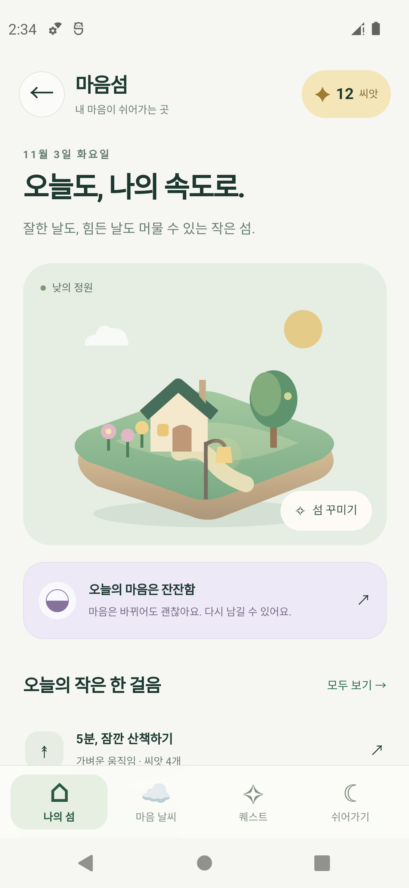

| 항목 | 설명 |
| --- | --- |
| 진입 | 예시 기록과 꾸미기가 있는 나의 섬 |
| 표시 상태 | 꽃·나무·조명이 배치된 정원. 오늘의 마음 날씨도 함께 표시한다. |
| 동작·데이터·검증 범위 | 예시 데이터로 구성한 설명용 장면이다. 생체정보로 감정을 추정한 결과가 아니다. |

[화면 인덱스로](#화면-인덱스)

## 09. 마음 날씨 — 저장 후 수정

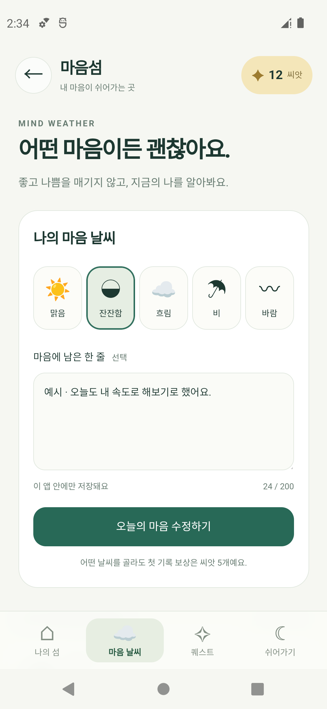

| 항목 | 설명 |
| --- | --- |
| 진입 | 마음 날씨 탭 → 기존 오늘 기록 |
| 표시 상태 | 저장한 날씨와 예시 메모가 입력 칸에 복원된다. 버튼이 수정하기로 바뀐다. |
| 동작·데이터·검증 범위 | 하루 한 날짜에 한 기록을 유지한다. 수정은 가능하지만 첫 기록 보상 5개를 다시 지급하지 않는다. |

[화면 인덱스로](#화면-인덱스)

## 10. 최근 일주일의 마음

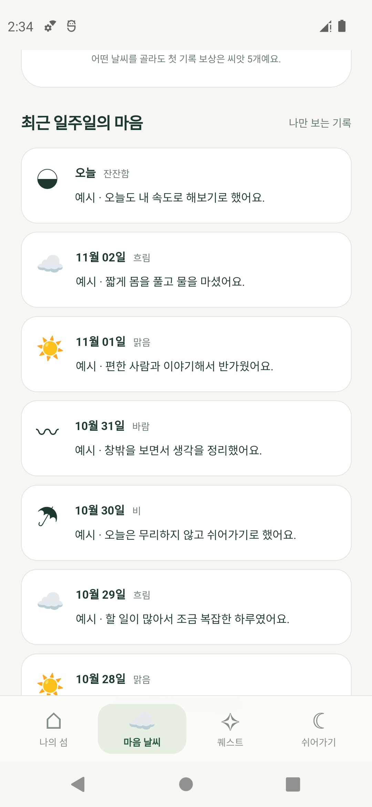

| 항목 | 설명 |
| --- | --- |
| 진입 | 마음 날씨 → 아래로 스크롤 |
| 표시 상태 | 날짜별 마음 날씨와 메모가 최신순으로 표시된다. |
| 동작·데이터·검증 범위 | 화면에는 최근 7일을 표시한다. 공개 메모는 모두 예시로 직접 만든 문장이다. |

[화면 인덱스로](#화면-인덱스)

## 11. 마음 기록 — 이전 날짜

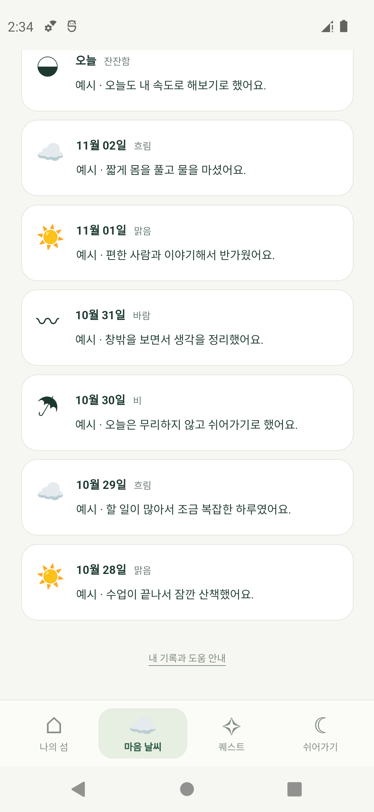

| 항목 | 설명 |
| --- | --- |
| 진입 | 히스토리 아래로 스크롤 |
| 표시 상태 | 더 이전 날짜의 예시 기록을 확인하는 모습. |
| 동작·데이터·검증 범위 | 앱 안에 저장한 기록이며 팀원이나 보호자에게 자동 공유되지 않는다. |

[화면 인덱스로](#화면-인덱스)

## 12. 섬 꾸미기 — 전체 진입

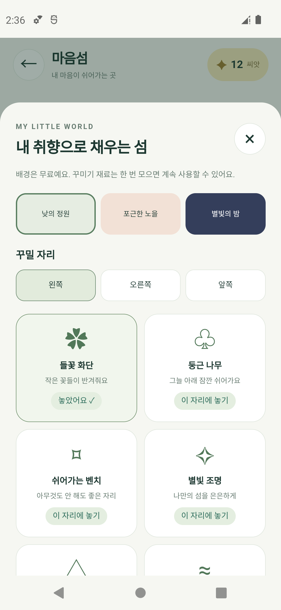

| 항목 | 설명 |
| --- | --- |
| 진입 | 나의 섬 → 섬 꾸미기 또는 씨앗 버튼 |
| 표시 상태 | 무료 배경 3종, 배치 자리 3개, 꾸미기 재료 목록. |
| 동작·데이터·검증 범위 | 이미 소유한 재료는 다시 씨앗을 쓰지 않고 배치한다. |

[화면 인덱스로](#화면-인덱스)

## 13. 섬 꾸미기 — 배치 자리 선택

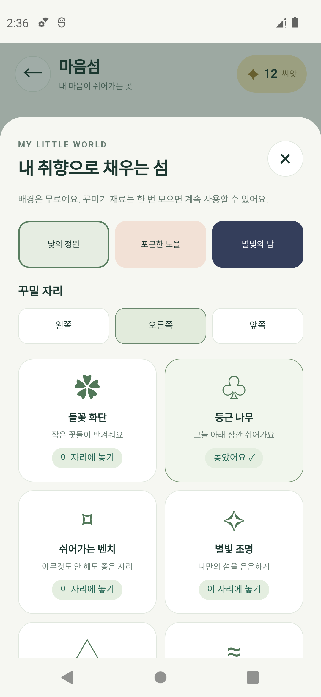

| 항목 | 설명 |
| --- | --- |
| 진입 | 꾸밀 자리 → 오른쪽 |
| 표시 상태 | 왼쪽·오른쪽·앞쪽 중 현재 선택한 자리가 강조된다. |
| 동작·데이터·검증 범위 | 같은 재료를 다른 자리에 놓으면 기존 자리에서 이동한다. 한 재료를 중복 배치하지 않는다. |

[화면 인덱스로](#화면-인덱스)

## 14. 섬 꾸미기 — 목록 하단

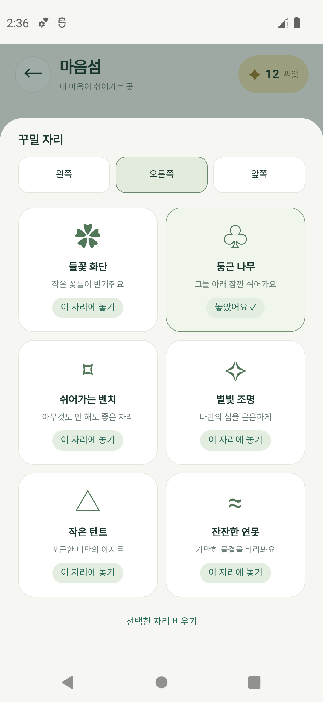

| 항목 | 설명 |
| --- | --- |
| 진입 | 꾸미기 목록 아래로 스크롤 |
| 표시 상태 | 텐트·연못 등 목록 하단과 선택한 자리 비우기. |
| 동작·데이터·검증 범위 | 자리를 비워도 재료 소유권과 모아둔 씨앗은 유지된다. |

[화면 인덱스로](#화면-인덱스)

## 15. 나의 섬 — 별빛의 밤

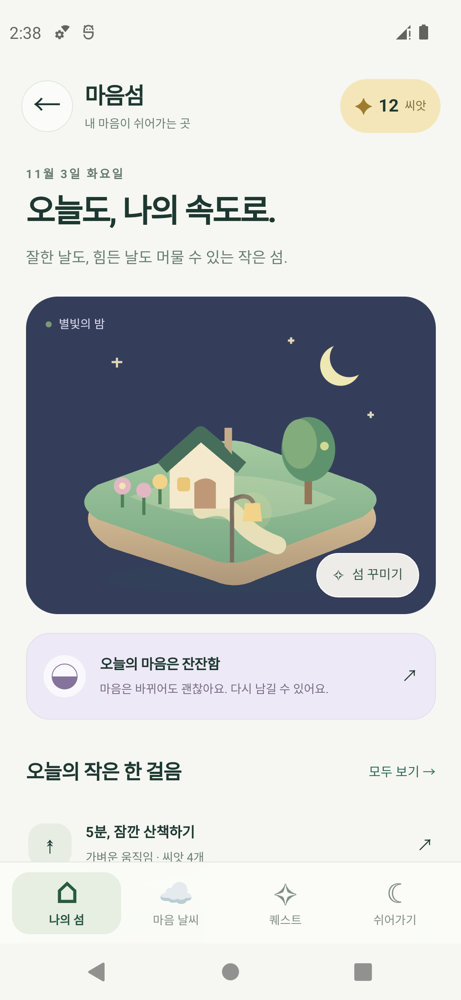

| 항목 | 설명 |
| --- | --- |
| 진입 | 꾸미기 → 별빛의 밤 |
| 표시 상태 | 달과 별이 있는 밤 배경. 섬과 배치한 재료는 그대로 유지된다. |
| 동작·데이터·검증 범위 | 배경 변경은 무료다. 기분의 좋고 나쁨에 따라 잠그거나 해제하지 않는다. |

[화면 인덱스로](#화면-인덱스)

## 16. 작은 퀘스트 — 진행 전

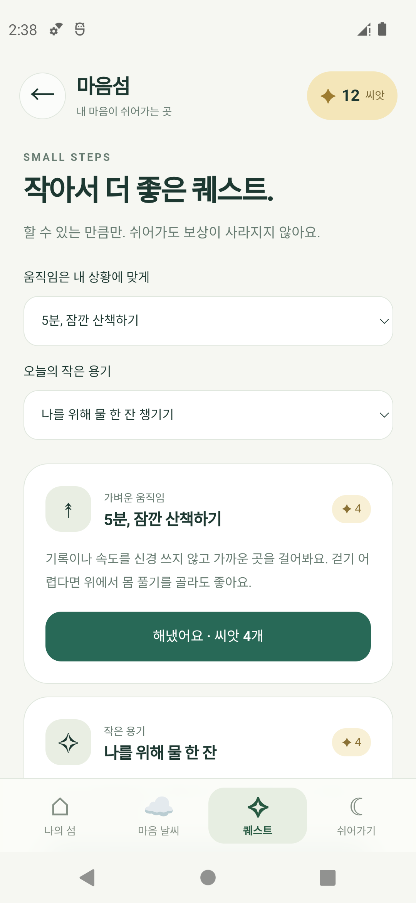

| 항목 | 설명 |
| --- | --- |
| 진입 | 퀘스트 탭 |
| 표시 상태 | 움직임과 작은 용기를 고르고 세 가지 퀘스트를 확인한다. |
| 동작·데이터·검증 범위 | 워치 센서가 완료를 판정하지 않는다. 활동 후 본인이 해냈어요를 눌러 기록한다. |

[화면 인덱스로](#화면-인덱스)

## 17. 움직임 퀘스트 선택

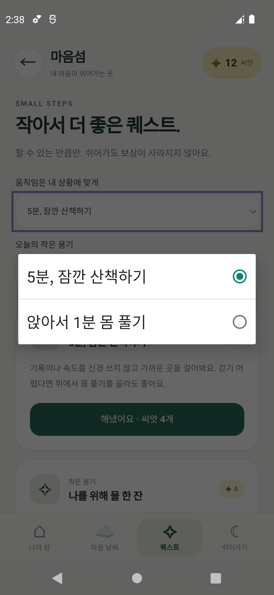

| 항목 | 설명 |
| --- | --- |
| 진입 | 움직임 선택 상자 |
| 표시 상태 | 5분 산책과 앉아서 1분 몸 풀기 중 선택. |
| 동작·데이터·검증 범위 | 걷기 어려운 상황에서도 같은 보상을 받는 대안을 제공한다. |

[화면 인덱스로](#화면-인덱스)

## 18. 작은 용기 선택

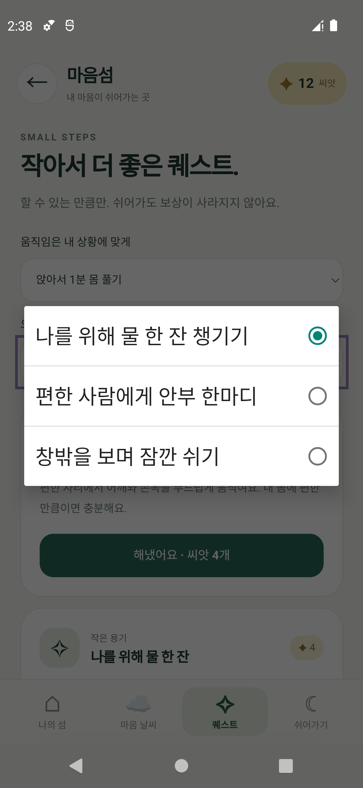

| 항목 | 설명 |
| --- | --- |
| 진입 | 오늘의 작은 용기 선택 상자 |
| 표시 상태 | 물 한 잔·편한 사람에게 안부·창밖을 보며 쉬기 중 선택. |
| 동작·데이터·검증 범위 | 연락이나 메시지를 앱이 대신 보내지 않는다. 부담스럽다면 다른 행동을 선택할 수 있다. |

[화면 인덱스로](#화면-인덱스)

## 19. 작은 퀘스트 — 완료

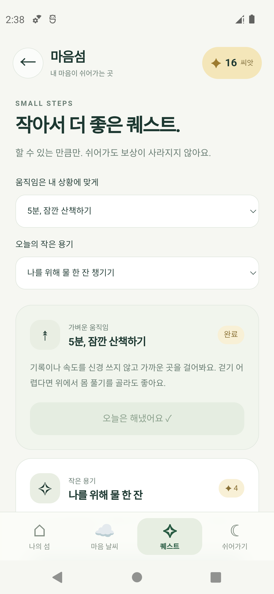

| 항목 | 설명 |
| --- | --- |
| 진입 | 활동 후 해냈어요 |
| 표시 상태 | 해당 퀘스트가 완료 표시로 바뀌고 버튼이 비활성화된다. |
| 동작·데이터·검증 범위 | 각 퀘스트는 하루 한 번 씨앗 4개를 지급한다. 반복 탭이나 선택 변경으로 중복 지급되지 않는다. |

[화면 인덱스로](#화면-인덱스)

## 20. 쉬어가기 — 시작 전

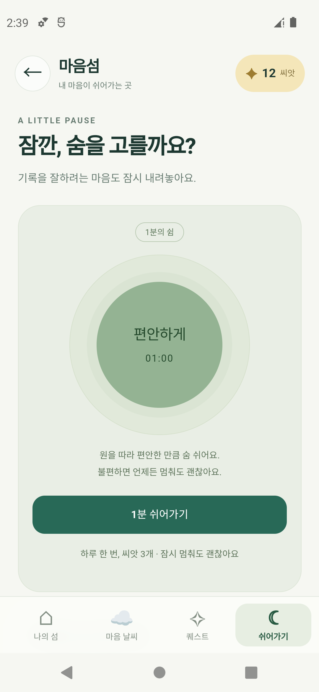

| 항목 | 설명 |
| --- | --- |
| 진입 | 쉬어가기 탭 |
| 표시 상태 | 1분 호흡 안내와 시작 버튼. |
| 동작·데이터·검증 범위 | 치료·진단 화면이 아니다. 편안한 만큼 따라 하고 언제든 멈출 수 있다. |

[화면 인덱스로](#화면-인덱스)

## 21. 쉬어가기 — 진행 중

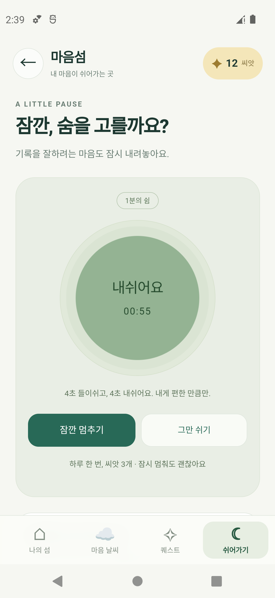

| 항목 | 설명 |
| --- | --- |
| 진입 | 1분 쉬어가기 |
| 표시 상태 | 원의 크기와 문구가 들이쉬기·내쉬기에 맞춰 바뀌고 남은 시간이 줄어든다. |
| 동작·데이터·검증 범위 | 안내는 4초 들이쉬기·4초 내쉬기다. 숨 참기를 요구하지 않는다. |

[화면 인덱스로](#화면-인덱스)

## 22. 쉬어가기 — 일시정지

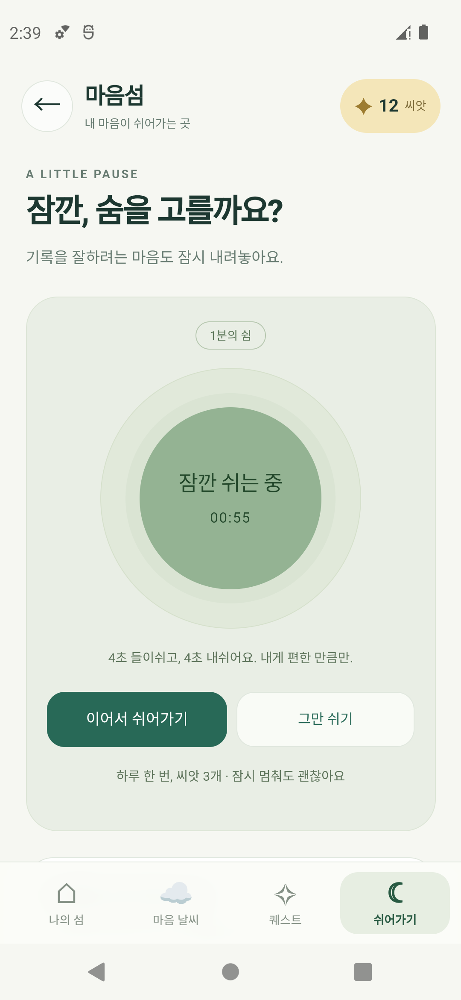

| 항목 | 설명 |
| --- | --- |
| 진입 | 잠깐 멈추기 |
| 표시 상태 | 남은 시간이 멈추고 이어서 쉬어가기 버튼이 표시된다. |
| 동작·데이터·검증 범위 | 탭 이동·백그라운드 전환 때도 일시정지한다. 멈춘 동안의 시간을 완료 시간에 넣지 않는다. |

[화면 인덱스로](#화면-인덱스)

## 23. 쉬어가기 — 완료

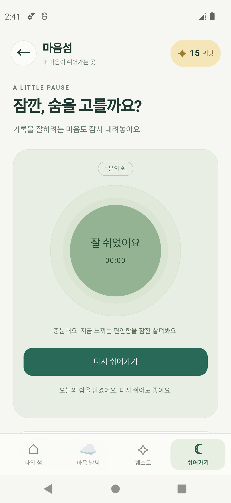

| 항목 | 설명 |
| --- | --- |
| 진입 | 실제 누적 60초 진행 |
| 표시 상태 | 잘 쉬었어요와 00:00, 다시 쉬어가기 안내. |
| 동작·데이터·검증 범위 | 하루 첫 완료만 씨앗 3개를 받는다. 이후에도 보상 없이 쉬어갈 수 있다. |

[화면 인덱스로](#화면-인덱스)

## 24. 내가 느낀 쉼

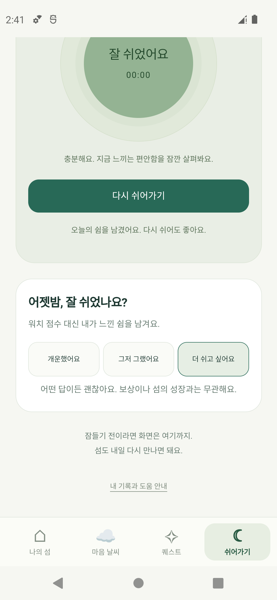

| 항목 | 설명 |
| --- | --- |
| 진입 | 쉬어가기 아래로 스크롤 |
| 표시 상태 | 개운함·그저 그랬음·더 쉬고 싶음 중 주관적인 느낌을 기록한다. |
| 동작·데이터·검증 범위 | 워치 수면 점수와 별개이며 점수·씨앗·섬의 성장에 영향을 주지 않는다. |

[화면 인덱스로](#화면-인덱스)

## 25. 내 기록과 도움 안내

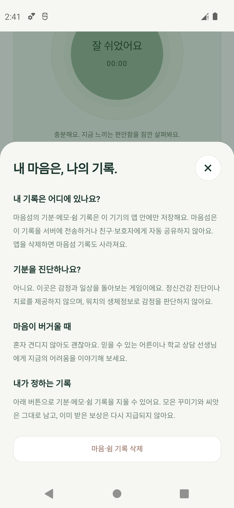

| 항목 | 설명 |
| --- | --- |
| 진입 | 화면 아래 → 내 기록과 도움 안내 |
| 표시 상태 | 저장 위치, 모듈의 데이터 전송 범위, 진단 아님, 도움 요청과 삭제 안내. |
| 동작·데이터·검증 범위 | 이 모듈의 기록 정책이다. 기존 제조사 앱과 타사 SDK 전체의 통신 정책을 대신하지 않는다. |

[화면 인덱스로](#화면-인덱스)

## 26. 마음·쉼 기록 삭제 확인

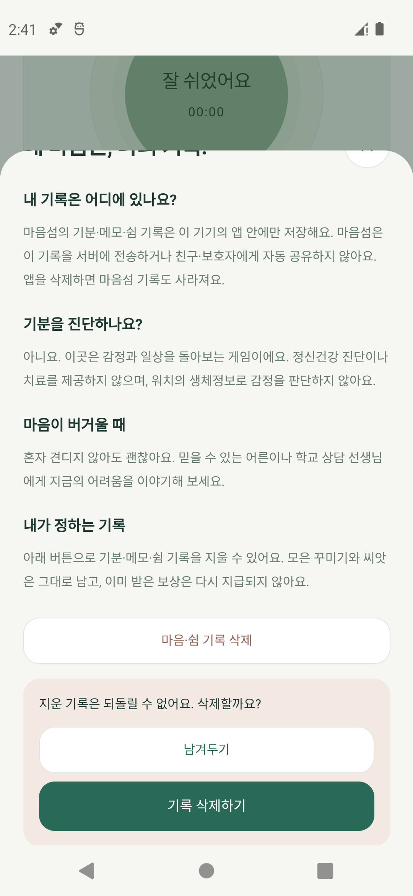

| 항목 | 설명 |
| --- | --- |
| 진입 | 안내 → 마음·쉼 기록 삭제 |
| 표시 상태 | 되돌릴 수 없다는 설명과 남겨두기·기록 삭제하기 버튼. |
| 동작·데이터·검증 범위 | 확인 전에는 삭제하지 않는다. 삭제 대상은 마음 날씨·메모·주관적 쉼 기록이다. |

[화면 인덱스로](#화면-인덱스)

## 27. 기록 삭제 후 빈 상태

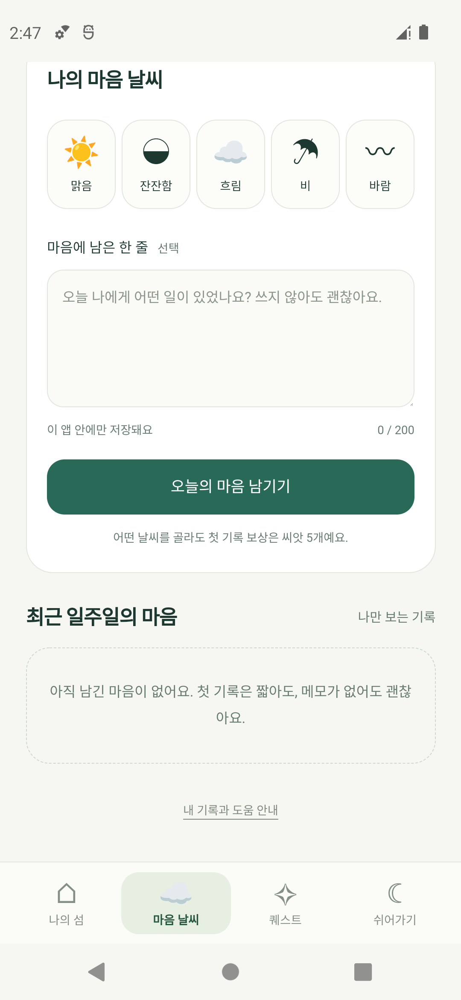

| 항목 | 설명 |
| --- | --- |
| 진입 | 삭제 확인 → 마음 날씨 히스토리 |
| 표시 상태 | 기록이 없는 히스토리 안내. |
| 동작·데이터·검증 범위 | 꾸미기·씨앗·기지급 보상 이력은 남는다. 지운 뒤 같은 날짜 기록을 다시 써도 보상을 재지급하지 않는다. |

[화면 인덱스로](#화면-인덱스)
