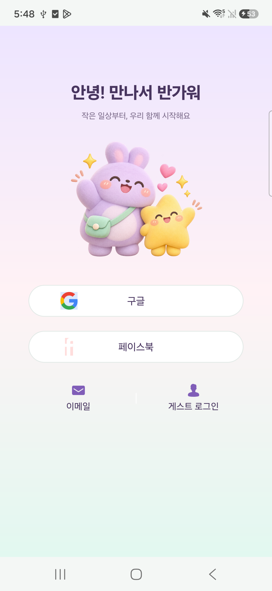
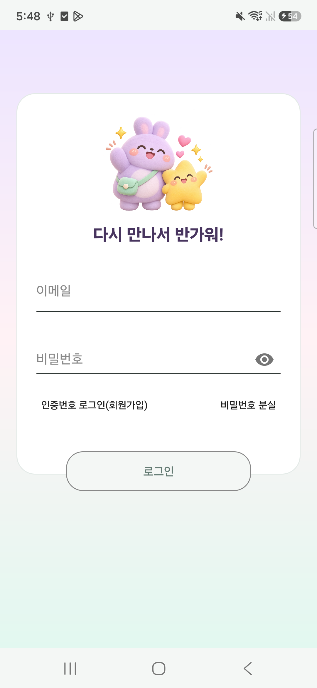
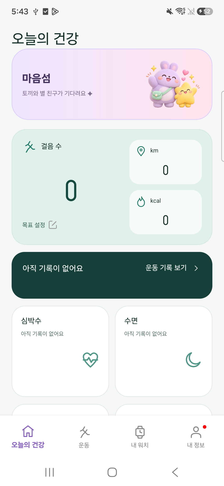
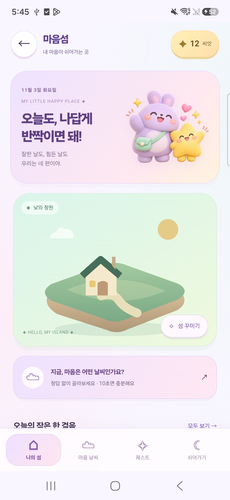
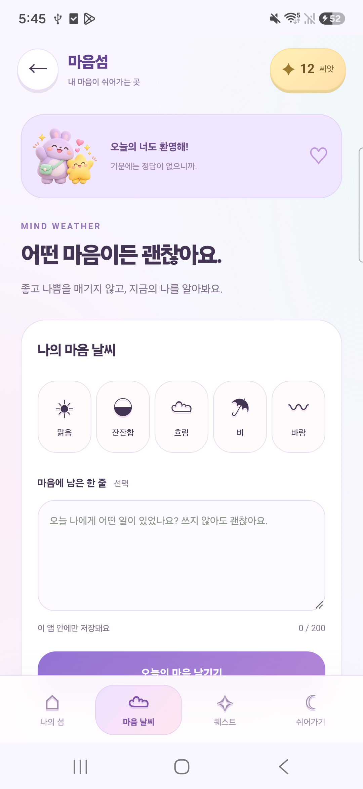
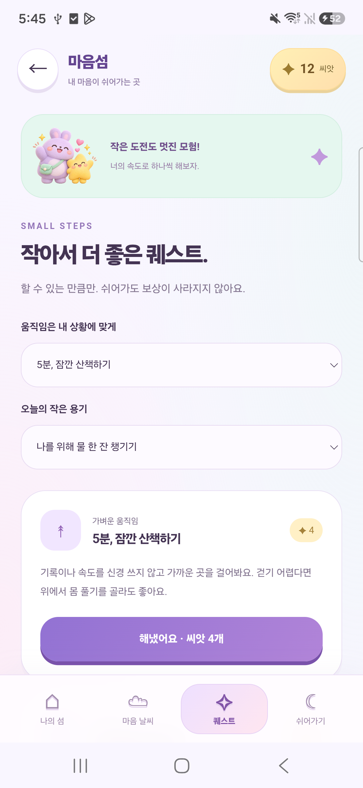
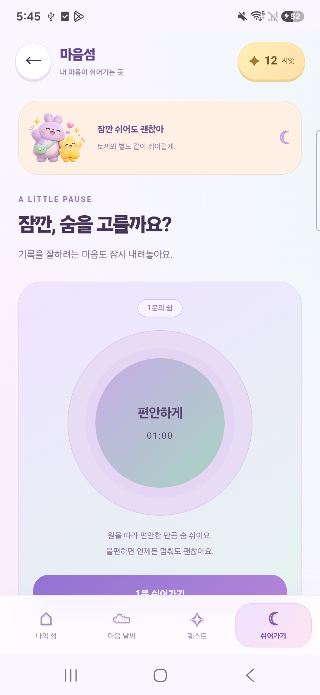

# 청소년 캐릭터 UI — 0.4.0

2026-11-03. 기존 앱 시작 화면의 남성 사이클 사진과 로그인 선택 화면의 여성 운동 사진을 화면에서 제거하고, 같은 캐릭터와 색상 체계를 사용하도록 수정했습니다.

## 변경한 화면

| 화면 | 변경 |
| --- | --- |
| 앱 시작·가이드 | 사진 대신 라벤더 토끼·노란 별과 환영 문구, 민트·분홍 그라데이션 |
| 로그인 선택 | 인물 배경 제거, 캐릭터 환영 영역과 둥근 로그인 버튼. 기존 계정 이벤트 유지 |
| 이메일 로그인 | 캐릭터·밝은 카드·환영 문구. 입력 뷰 ID와 로그인 처리 유지 |
| 건강 홈 | 마음섬 진입 카드에 캐릭터 추가 |
| 나의 섬 | 캐릭터 배너, 파스텔 섬 배경, 스티커, 보라색 버튼 |
| 마음 날씨·퀘스트·쉼 | 캐릭터 안내 카드와 라벤더·민트·복숭아색 카드 |
| Android 16 | 시스템 바·카메라 영역·키보드 인셋을 네이티브 컨테이너에서 반영 |

화면 디자인 변경이며 감정·보상·데이터 모델의 규칙과 저장 파일 형식은 바꾸지 않았습니다. 같은 앱 ID와 로컬 키로 업데이트하며 앱 제거·데이터 초기화를 하지 않습니다. 계정 로그인, 제조사 서버, 실제 워치 연결이 새로 구현된 것은 아닙니다.

## 빌드

```powershell
.\scripts\Build.ps1 -IdentityProfile .\profiles\diz-sw01-teen-ui.json
```

결과: `dist/Diz_SW01_Teen_UI_0.4.0_ARM64_TEST.apk`. 환경 준비는 [BUILD](BUILD.md), 과거 0.3.0 기능과 검증은 [MIND_ISLAND](MIND_ISLAND.md)를 참고하세요.

## 캐릭터 이미지

내장 ImageGen 도구로 새로 생성한 투명 PNG를 사용했습니다. 원본을 프로젝트에 복사했으며 외부 URL을 호출하지 않습니다.

- Android 리소스: `patches/base/res/drawable/diz_mascots.png`
- 로컬 게임: `patches/base/assets/mind-island/mascots.png`
- 실사용 이미지: [캐릭터 PNG](../patches/base/assets/mind-island/mascots.png)

생성 프롬프트:

> Create a production-ready transparent PNG mascot illustration for a Korean teen wellbeing mobile app, no text. Two original friendly characters: a round fluffy lilac bunny with very short soft ears and tiny peach cheeks wearing a mint crossbody pouch, alongside a small warm-yellow star-shaped companion, both waving gently. Sophisticated cute sticker / soft 3D clay illustration for teenagers, not babyish, rounded pillowy forms, subtle grain and soft studio shadows, clean confident silhouettes, lavender mint peach butter-yellow palette. Few tiny pink hearts and sparkling stars floating close around the pair. Entire characters fully visible, centered composition occupying 80% of square canvas, no scene or backdrop, genuine transparent alpha background. No humans, no photos, no logos, no lettering, no watermark. Asset to reuse as welcome hero and app mascot.

게임 배너의 가벼운 움직임은 `prefers-reduced-motion`에서 중지합니다. 주요 버튼·내비게이션·저장 상태·삭제 확인 흐름은 유지합니다.

## 실제 Galaxy S25 화면

2026-11-03 Android 16/ARM64에서 같은 키로 0.3.0 위 업데이트 설치 성공, versionCode 4 확인. 아래는 실제 휴대폰의 원본 캡처입니다. 건강 측정값과 게임 기록은 빈 상태이며 계정 식별자는 제외했습니다. 로그인 화면은 로그아웃 없이 임시 동일 서명 계측 도구로 열어 확인했고, 자격 증명 입력이나 로그인 요청은 하지 않았습니다.

<table><tr><th>로그인 선택 · 인물 사진 제거</th><th>이메일 로그인</th></tr><tr><td></td><td></td></tr></table>
<table><tr><th>건강 홈</th><th>나의 섬</th></tr><tr><td></td><td></td></tr></table>
<table><tr><th>마음 날씨</th><th>퀘스트</th><th>쉬어가기</th></tr><tr><td></td><td></td><td></td></tr></table>

## 이번 버전 확인 범위

- 변경 XML 파싱, 기존 뷰 ID·계정 onClick 핸들러 보존 검사.
- Java Activity 컴파일, DEX20 생성, 전체 재조립, 서명 v2·v3 및 ZIP 정렬 검증 통과.
- 실제 휴대폰 업데이트 설치, 건강 홈 → 게임 진입, 4개 메뉴 전환과 캐릭터 이미지 로딩 확인.
- Android 16 상태 표시줄과 게임 제목이 겹치지 않는 것 확인.
- APK에 포함된 HTML/CSS/JS/캐릭터 PNG가 소스와 일치. 네이티브 라이브러리 50개 바이트 유지.
- 감정·보상 모델은 변경하지 않았으며 이번 UI 작업에서 기존 60초 타이머·보상 시나리오를 전수 반복하지 않았음.

검증 APK SHA-256: `344b72130dff3df31ae32ff7969ec19407edcf1d8857f746603e44998140253c`.

온라인 원 제조사 강제 업데이트 안내는 실제 폰에서도 재현됐습니다. 이번 UI 수정에서 해당 정책을 해결한 것은 아닙니다. 기존 전체 실기기 설치 차단 이력과 별개로 **이번 0.4.0 APK의 이 휴대폰 설치는 성공**했으며, 이것을 앱 전체 안전성 판정·서버 로그인·워치 연결 검증으로 확대하지 않습니다.
